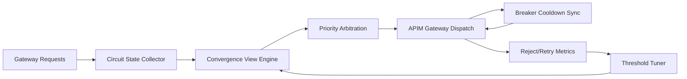

# APIM Gateway Circuit Entropy Selection FAQ (Cycle 1907)

## 1) Three-minute decision
- **Core issue:** under layered breaker policies, AI gateways can develop circuit entropy where similar requests follow divergent breaker paths.
- **Recommendation:** apply circuit-state convergence, deterministic policy arbitration, and cooldown synchronization.
- **Goal:** keep breaker decisions consistent during fault windows and reduce jitter plus false rejection.

## 2) Q1 / Q2 / Q3
### Q1: What is gateway circuit entropy?
1) similar requests trigger different breaker branches on different instances,
2) unsynchronized cooldown windows drift policy behavior,
3) retries plus fallback chains amplify uncertainty.

### Q2: How should production entropy control be designed?
- **State convergence:** aggregate circuit states into a global convergence view,
- **Priority arbitration:** deterministically resolve policy conflicts,
- **Cooldown sync:** align breaker recovery cadence per region,
- **Feedback loop:** tune thresholds using false-reject metrics.

### Q3: What is the go-live bar?
- lower breaker-path divergence rate,
- converged false-reject and retry-amplification rates,
- reduced throughput variance during recovery windows.

## 3) Reference architecture

## 4) Decision matrix
| Dimension | No entropy control | Circuit Entropy Control (Recommended) |
|---|---:|---:|
| Breaker consistency | Low | High |
| False-reject control | Low | High |
| Recovery smoothness | Medium | High |
| Implementation complexity | Low | Medium |
| Observability explainability | Medium | High |

## 5) Evidence and reproducibility
- Evidence files:
  - `workshops/azure-agent-infra/evidence/cycle-1907-benchmark.json`
  - `workshops/azure-agent-infra/evidence/cycle-1907-latency.csv`
  - `workshops/azure-agent-infra/evidence/cycle-1907-throughput.csv`
  - `workshops/azure-agent-infra/evidence/cycle-1907-policy.csv`
- Labels: `measured / synthetic / anonymized_reported`.
- Validation chain: six-part FAQ, CSP, cycle/topic binding, simulator checks.

## 6) Production checklist
- [ ] Circuit convergence view supports cross-instance aggregation.
- [ ] Priority arbitration is deterministic and replayable.
- [ ] Cooldown sync windows pass fault drills.
- [ ] Divergence and false-reject signals are alertable.
- [ ] FAQ/H5/SVG/7-card/evidence remain cycle-consistent.
