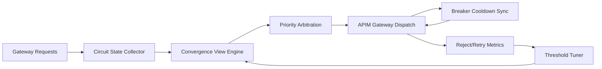

# APIM Gateway Circuit Entropy 选型 FAQ（Cycle 1907）

## 1) 3 分钟结论
- **核心问题：** AI Gateway 在多策略熔断链路下会出现 circuit entropy（熔断状态发散），导致同类请求在不同路径表现不一致。
- **推荐方案：** “熔断状态收敛器 + 策略优先级仲裁 + 熔断冷却同步”三段治理。
- **目标：** 在故障窗口内保持熔断决策一致性，减少抖动与误拒绝。

## 2) Q1 / Q2 / Q3
### Q1：什么是 gateway circuit entropy？
1) 同一请求在不同实例触发不同熔断分支；
2) 熔断冷却时间不一致导致策略漂移；
3) 重试和降级逻辑叠加放大不确定性。

### Q2：生产级熔断熵治理如何设计？
- **状态收敛器：** 聚合同类 circuit 状态并计算全局收敛视图；
- **仲裁优先级：** 在冲突策略间执行确定性优先级选择；
- **冷却同步：** 在区域内同步熔断恢复节奏；
- **反馈闭环：** 依据误拒绝率动态调整阈值与窗口。

### Q3：上线判据是什么？
- 熔断路径分歧率显著下降；
- 误拒绝率和重试放大率同步收敛；
- 故障恢复窗口中吞吐波动减小。

## 3) 架构图

## 4) 选型矩阵
| 维度 | 无熵治理 | Circuit Entropy Control（推荐） |
|---|---:|---:|
| 熔断一致性 | 低 | 高 |
| 误拒绝控制 | 低 | 高 |
| 故障恢复平滑度 | 中 | 高 |
| 实施复杂度 | 低 | 中 |
| 观测可解释性 | 中 | 高 |

## 5) 证据与复算口径
- 证据文件：
  - `workshops/azure-agent-infra/evidence/cycle-1907-benchmark.json`
  - `workshops/azure-agent-infra/evidence/cycle-1907-latency.csv`
  - `workshops/azure-agent-infra/evidence/cycle-1907-throughput.csv`
  - `workshops/azure-agent-infra/evidence/cycle-1907-policy.csv`
- 标签：`measured / synthetic / anonymized_reported`。
- 校验链：FAQ 六段、CSP、cycle/topic 绑定、模拟器检查。

## 6) 生产检查清单
- [ ] circuit 状态收敛视图支持跨实例聚合。
- [ ] 策略优先级仲裁具备确定性回放能力。
- [ ] 冷却同步窗口经过故障演练验证。
- [ ] 熔断分歧率与误拒绝率已接入告警。
- [ ] FAQ/H5/SVG/7-card/evidence 轮次一致。
