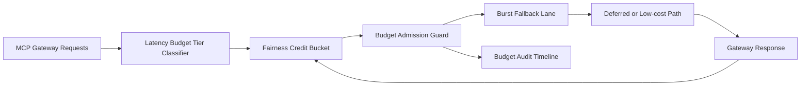

# APIM Gateway MCP Latency Budget Fairness Burst Selection FAQ (Cycle 1925)

## 1) Three-minute decision
- **Core issue:** under burst load, globally shared latency budgets let non-critical paths starve critical chains and drift P95 latency.
- **Recommendation:** combine tiered latency budgeting, fairness credit buckets, and over-budget fallback lanes.
- **Goal:** reduce latency-budget unfairness while keeping burst-window response stable.

## 2) Q1 / Q2 / Q3
### Q1: Why enforce latency-budget fairness burst?
1) global budget pools amplify high-frequency contention across tenants,
2) without credit buckets, bursts quickly deplete usable budget,
3) without fallback lanes, over-budget requests timeout or fail.

### Q2: How should production design work?
- **Tier layer:** partition latency budget lanes by tenant+tier+toolclass,
- **Credit layer:** assign per-lane fairness credit buckets with refill cadence,
- **Fallback layer:** over-budget requests degrade to low-cost model or deferred lane,
- **Audit layer:** persist budget spend, fallback hits, and recovery traces.

### Q3: What is the go-live bar?
- lower latency-budget unfairness and timeout rates,
- stable critical throughput in burst windows,
- replayable and auditable budget/fallback actions.

## 3) Reference architecture

## 4) Decision matrix
| Dimension | Global shared latency budget | Latency Budget Fairness Burst (Recommended) |
|---|---:|---:|
| Critical request protection | Low | High |
| Peak stability | Medium | High |
| Latency cost control | Medium | High |
| Operational explainability | Medium | High |
| Implementation complexity | Low | Medium |

## 5) Evidence and reproducibility
- Evidence files:
  - `workshops/azure-agent-infra/evidence/cycle-1925-benchmark.json`
  - `workshops/azure-agent-infra/evidence/cycle-1925-latency.csv`
  - `workshops/azure-agent-infra/evidence/cycle-1925-throughput.csv`
  - `workshops/azure-agent-infra/evidence/cycle-1925-cost.csv`
- Labels: `measured / synthetic / anonymized_reported`.
- Repro method: fixed sampling window, fixed latency-budget fairness policy, fixed cost model.

## 6) Production checklist
- [ ] Latency-budget tiering aligns with tenant boundaries.
- [ ] Fairness-credit parameters pass historical replay verification.
- [ ] Over-budget fallback includes cooldown and rollback switches.
- [ ] Budget/fallback/recover trails are tenant-auditable.
- [ ] FAQ/H5/SVG/7-card/evidence remain cycle-topic consistent.
