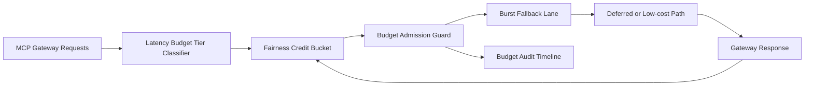

# APIM Gateway MCP Latency Budget Fairness Burst 选型 FAQ（Cycle 1925）

## 1) 3 分钟结论
- **核心问题：** MCP 路由在突发时若延迟预算按全局共享，会导致关键链路被非关键请求挤占并触发 P95 漂移。
- **推荐方案：** “延迟预算分层 + 公平信用桶 + 超预算回退车道”三层治理。
- **目标：** 压低延迟预算不公平率并稳定高峰窗口的响应抖动。

## 2) Q1 / Q2 / Q3
### Q1：为什么要做 latency budget fairness burst？
1) 全局预算会放大高频租户对低频租户的延迟挤占；
2) 无信用桶时突发会迅速耗尽可用预算；
3) 无回退车道时超预算请求只能超时或失败。

### Q2：生产级如何设计？
- **分层层：** 按 tenant+tier+toolclass 划分延迟预算车道；
- **信用层：** 每车道配置公平信用桶与回补周期；
- **回退层：** 超预算请求降级到低成本模型或延迟执行；
- **审计层：** 记录预算消耗、回退命中与恢复轨迹。

### Q3：上线判据是什么？
- 延迟预算不公平率与超时率持续下降；
- 高峰窗口关键请求吞吐保持稳定；
- 预算与回退动作可审计、可重放、可复算。

## 3) 架构图

## 4) 选型矩阵
| 维度 | 全局共享延迟预算 | Latency Budget Fairness Burst（推荐） |
|---|---:|---:|
| 关键请求保障 | 低 | 高 |
| 峰值稳定性 | 中 | 高 |
| 延迟成本可控性 | 中 | 高 |
| 运维可解释性 | 中 | 高 |
| 实施复杂度 | 低 | 中 |

## 5) 证据与复算口径
- 证据文件：
  - `workshops/azure-agent-infra/evidence/cycle-1925-benchmark.json`
  - `workshops/azure-agent-infra/evidence/cycle-1925-latency.csv`
  - `workshops/azure-agent-infra/evidence/cycle-1925-throughput.csv`
  - `workshops/azure-agent-infra/evidence/cycle-1925-cost.csv`
- 标签：`measured / synthetic / anonymized_reported`。
- 口径：固定采样窗口、固定延迟预算公平策略、固定成本模型，支持重复复算。

## 6) 生产检查清单
- [ ] 延迟预算分层规则与租户边界一致。
- [ ] 公平信用桶参数通过历史回放验证。
- [ ] 超预算回退策略具备冷却与回滚开关。
- [ ] 预算/回退/恢复轨迹可按租户审计。
- [ ] FAQ/H5/SVG/7-card/evidence 的 cycle/topic 一致。
