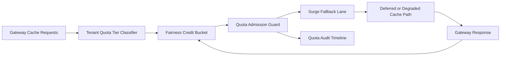

# APIM Gateway Tenant Cache Quota Fairness Surge Selection FAQ (Cycle 1924)

## 1) Three-minute decision
- **Core issue:** under surge traffic, globally shared cache quotas let high-frequency tenants dominate and starve critical requests.
- **Recommendation:** combine tenant-tiered cache quotas, fairness credit buckets, and surge fallback lanes.
- **Goal:** reduce quota unfairness and keep peak response latency stable.

## 2) Q1 / Q2 / Q3
### Q1: Why enforce tenant cache quota fairness surge?
1) global cache quotas amplify high-frequency tenant contention,
2) without credit buckets, bursts quickly deplete usable cache quota,
3) without fallback lanes, over-quota requests time out or fail.

### Q2: How should production design work?
- **Tier layer:** partition cache quota lanes by tenant+tier+intent,
- **Credit layer:** assign per-lane fairness credit buckets with refill cadence,
- **Fallback layer:** over-quota requests route to degraded cache strategy or deferred lane,
- **Audit layer:** persist quota spend, fallback hits, and recovery traces.

### Q3: What is the go-live bar?
- lower cache-quota unfairness and timeout rates,
- stable critical throughput in burst windows,
- replayable and auditable quota/fallback actions.

## 3) Reference architecture

## 4) Decision matrix
| Dimension | Global shared cache quota | Tenant Cache Quota Fairness Surge (Recommended) |
|---|---:|---:|
| Critical request protection | Low | High |
| Peak stability | Medium | High |
| Cache cost control | Medium | High |
| Operational explainability | Medium | High |
| Implementation complexity | Low | Medium |

## 5) Evidence and reproducibility
- Evidence files:
  - `workshops/azure-agent-infra/evidence/cycle-1924-benchmark.json`
  - `workshops/azure-agent-infra/evidence/cycle-1924-latency.csv`
  - `workshops/azure-agent-infra/evidence/cycle-1924-throughput.csv`
  - `workshops/azure-agent-infra/evidence/cycle-1924-cost.csv`
- Labels: `measured / synthetic / anonymized_reported`.
- Repro method: fixed sampling window, fixed cache-quota fairness policy, fixed cost model.

## 6) Production checklist
- [ ] Cache-quota tiering aligns with tenant boundaries.
- [ ] Fairness-credit parameters pass historical replay verification.
- [ ] Surge fallback includes cooldown and rollback switches.
- [ ] Quota/fallback/recover trails are tenant-auditable.
- [ ] FAQ/H5/SVG/7-card/evidence remain cycle-topic consistent.
