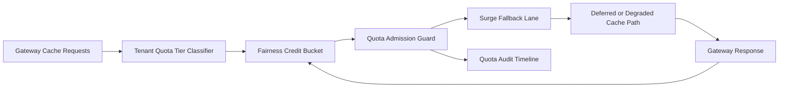

# APIM Gateway Tenant Cache Quota Fairness Surge 选型 FAQ（Cycle 1924）

## 1) 3 分钟结论
- **核心问题：** 多租户缓存在突发流量下若配额按全局共享，会出现高频租户长期占优与关键请求饥饿。
- **推荐方案：** “租户缓存配额分层 + 公平信用桶 + 突发回退车道”三层治理。
- **目标：** 压低缓存配额不公平率并稳定高峰期响应延迟。

## 2) Q1 / Q2 / Q3
### Q1：为什么要做 tenant cache quota fairness surge？
1) 全局缓存配额会放大高频租户对低频租户的挤占；
2) 无信用桶时短时突发会耗尽可用缓存额度；
3) 无回退车道时超额请求只能超时或失败。

### Q2：生产级如何设计？
- **分层层：** 按 tenant+tier+intent 划分缓存配额车道；
- **信用层：** 每车道配置公平信用桶与回补周期；
- **回退层：** 超额请求走降级缓存策略或延迟执行；
- **审计层：** 记录配额消耗、回退命中与恢复轨迹。

### Q3：上线判据是什么？
- 缓存配额不公平率与超时率持续下降；
- 高峰窗口关键请求吞吐保持稳定；
- 配额与回退动作可审计、可重放、可复算。

## 3) 架构图

## 4) 选型矩阵
| 维度 | 全局共享缓存配额 | Tenant Cache Quota Fairness Surge（推荐） |
|---|---:|---:|
| 关键请求保障 | 低 | 高 |
| 峰值稳定性 | 中 | 高 |
| 缓存成本可控性 | 中 | 高 |
| 运维可解释性 | 中 | 高 |
| 实施复杂度 | 低 | 中 |

## 5) 证据与复算口径
- 证据文件：
  - `workshops/azure-agent-infra/evidence/cycle-1924-benchmark.json`
  - `workshops/azure-agent-infra/evidence/cycle-1924-latency.csv`
  - `workshops/azure-agent-infra/evidence/cycle-1924-throughput.csv`
  - `workshops/azure-agent-infra/evidence/cycle-1924-cost.csv`
- 标签：`measured / synthetic / anonymized_reported`。
- 口径：固定采样窗口、固定缓存配额公平策略、固定成本模型，支持重复复算。

## 6) 生产检查清单
- [ ] 缓存配额分层规则与租户边界一致。
- [ ] 公平信用桶参数通过历史回放验证。
- [ ] 突发回退策略具备冷却与回滚开关。
- [ ] 配额/回退/恢复轨迹可按租户审计。
- [ ] FAQ/H5/SVG/7-card/evidence 的 cycle/topic 一致。
