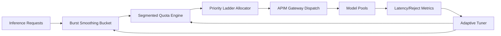

# APIM Inference Quota Burst Smoothing Selection FAQ (Cycle 1899)

## 1) Three-minute decision
- **Core issue:** under traffic spikes, fixed quota windows in AI gateways produce burst-then-starve behavior and destabilize downstream model pools.
- **Recommendation:** combine leak buckets, segmented quota smoothing, and tenant priority ladders.
- **Goal:** smooth spikes, stabilize inference latency, and improve quota fairness.

## 2) Q1 / Q2 / Q3
### Q1: Why do fixed quota windows misbehave?
1) production traffic is bursty at second-level granularity,
2) window boundaries encourage request bunching,
3) quota depletion causes slow recovery for critical tenants.

### Q2: How should production burst smoothing be designed?
- **Leak bucket:** absorb short spikes and shape emission rate,
- **Segmented smoothing:** enforce budgets at 5s/30s/5min layers,
- **Priority ladder:** preserve minimum quotas for core tenants at saturation,
- **Feedback tuning:** adapt bucket parameters using reject and tail-latency signals.

### Q3: What is the go-live bar?
- no sawtooth instability on P95/P99 during peaks,
- reduced rejection and retry amplification rates,
- per-throughput cost remains within target budget.

## 3) Reference architecture

## 4) Decision matrix
| Dimension | Fixed-window quota | Burst Smoothing (Recommended) |
|---|---:|---:|
| Peak stability | Low | High |
| Tenant fairness | Medium | High |
| Tail-latency control | Low | High |
| Implementation complexity | Low | Medium |
| Cost predictability | Medium | High |

## 5) Evidence and reproducibility
- Evidence files:
  - `workshops/azure-agent-infra/evidence/cycle-1899-benchmark.json`
  - `workshops/azure-agent-infra/evidence/cycle-1899-latency.csv`
  - `workshops/azure-agent-infra/evidence/cycle-1899-throughput.csv`
  - `workshops/azure-agent-infra/evidence/cycle-1899-cost.csv`
- Labels: `measured / synthetic / anonymized_reported`.
- Validation chain: six-part FAQ, CSP, cycle/topic binding, simulator checks.

## 6) Production checklist
- [ ] Three-layer quota windows and bucket parameters are versioned.
- [ ] Priority ladder is integrated with tenant tiers.
- [ ] Dashboards cover reject/retry/tail-latency signals.
- [ ] Adaptive tuning has rollback and freeze switches.
- [ ] FAQ/H5/SVG/7-card/evidence remain cycle-consistent.
