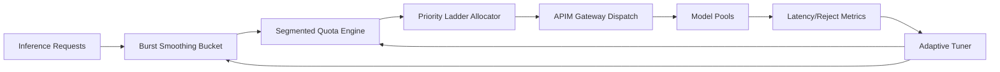

# APIM Inference Quota Burst Smoothing 选型 FAQ（Cycle 1899）

## 1) 3 分钟结论
- **核心问题：** AI Gateway 在高峰瞬时流量下，固定配额窗口会触发“先突刺后饥饿”，导致下游模型池抖动。
- **推荐方案：** “令牌泄洪桶 + 分段配额平滑 + 租户优先级阶梯”联合机制。
- **目标：** 平滑突刺流量，稳定下游推理延迟并提升配额公平性。

## 2) Q1 / Q2 / Q3
### Q1：为什么固定 quota window 会失真？
1) 业务流量常呈秒级脉冲，不符合均值假设；
2) 窗口边界会诱发请求扎堆；
3) 配额耗尽后恢复慢，影响关键租户。

### Q2：生产级 burst smoothing 怎么设计？
- **泄洪桶：** 对突刺流量做短时吸收与速率整形；
- **分段平滑：** 按 5s/30s/5min 三层预算同步约束；
- **优先级阶梯：** 核心租户在饱和时获得最小保障配额；
- **反馈调参：** 依据拒绝率与尾延迟动态调整桶参数。

### Q3：上线判据是什么？
- 高峰窗口 P95/P99 不再出现锯齿型失稳；
- 拒绝率与重试放大率同步下降；
- 单位吞吐成本保持在目标预算。

## 3) 架构图

## 4) 选型矩阵
| 维度 | 固定窗口配额 | Burst Smoothing（推荐） |
|---|---:|---:|
| 峰值稳定性 | 低 | 高 |
| 租户公平性 | 中 | 高 |
| 尾延迟可控性 | 低 | 高 |
| 实施复杂度 | 低 | 中 |
| 成本可预测性 | 中 | 高 |

## 5) 证据与复算口径
- 证据文件：
  - `workshops/azure-agent-infra/evidence/cycle-1899-benchmark.json`
  - `workshops/azure-agent-infra/evidence/cycle-1899-latency.csv`
  - `workshops/azure-agent-infra/evidence/cycle-1899-throughput.csv`
  - `workshops/azure-agent-infra/evidence/cycle-1899-cost.csv`
- 标签：`measured / synthetic / anonymized_reported`。
- 校验链：FAQ 六段、CSP、cycle/topic 绑定、模拟器检查。

## 6) 生产检查清单
- [ ] 三层配额窗口与桶参数已版本化。
- [ ] 优先级阶梯与租户分级策略联调完成。
- [ ] 拒绝率、重试率、尾延迟看板齐备。
- [ ] 自适应调参具备回滚与冻结开关。
- [ ] FAQ/H5/SVG/7-card/evidence 轮次一致。
