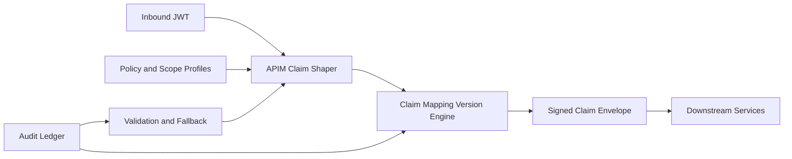

# APIM JWT Claim Shaping Selection FAQ (Cycle 1862)

## 1) Three-minute decision
- **Core tradeoff:** forwarding full JWT preserves context but increases downstream parsing cost and sensitive-claim exposure.
- **Recommendation:** gateway-side claim shaping (minimum-necessary projection), versioned mapping, and signed traceable envelopes.
- **Goal:** reduce exposure and auth-path overhead without weakening authorization semantics.

## 2) Q1 / Q2 / Q3
### Q1: Why is raw JWT pass-through unsustainable?
1) downstream services repeatedly parse irrelevant claims,
2) unnecessary PII/org attributes widen exposure scope,
3) claim drift across multi-hop chains is hard to attribute.

### Q2: What production-grade claim-shaping strategy should be used?
- **Minimal projection:** keep only claims required for resource access,
- **Versioned mapping:** version claim-shaping rules for phased rollout,
- **Signed envelope:** sign transformed claims and attach trace-id,
- **Fallback path:** on shaping failure, fall back to secure minimal set.

### Q3: How do we validate effectiveness?
- lower downstream auth processing latency,
- reduced sensitive-claim exposure surface,
- stable success and consistency during rule changes.

## 3) Reference architecture

## 4) Decision matrix
| Dimension | Raw JWT pass-through | Claim shaping (Recommended) |
|---|---:|---:|
| Sensitive exposure control | Low | High |
| Downstream performance | Medium | High |
| Rule evolution control | Low | High |
| Implementation complexity | Low | Medium |
| Audit traceability | Low | High |

## 5) Evidence and reproducibility
- Evidence files:
  - `workshops/azure-agent-infra/evidence/cycle-1862-benchmark.json`
  - `workshops/azure-agent-infra/evidence/cycle-1862-latency.csv`
  - `workshops/azure-agent-infra/evidence/cycle-1862-throughput.csv`
  - `workshops/azure-agent-infra/evidence/cycle-1862-policy.csv`
- Labels: `measured / synthetic / anonymized_reported`.
- validation7 enforces bilingual six-part structure, CSP self-contained 7-card output, strict cycle-evidence alignment, and replayability.

## 6) Production checklist
- [ ] Minimal claim-projection rules are frozen.
- [ ] Versioned mapping rollout strategy is validated.
- [ ] Signed envelope and trace-id chain are active.
- [ ] Failure fallback path passes load checks.
- [ ] FAQ/H5/SVG/7-card align with cycle evidence.
