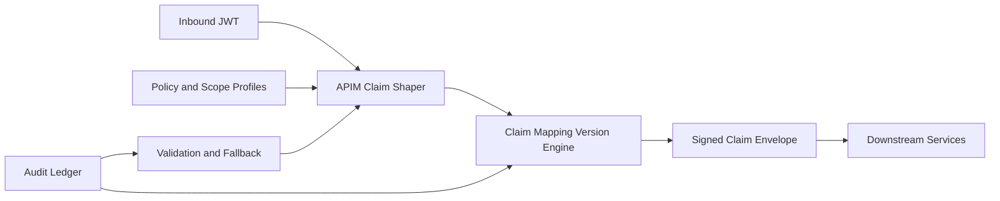

# APIM JWT Claim Shaping 选型 FAQ（Cycle 1862）

## 1) 3 分钟结论
- **核心矛盾：** 透传完整 JWT 能保留上下文，但会扩大下游解析负担与敏感声明暴露面。
- **推荐：** 网关侧 Claim Shaping（最小必要声明投影）+ 版本化映射 + 签名追踪。
- **目标：** 在不损失鉴权能力的前提下降低泄露风险、缩短下游鉴权路径。

## 2) Q1 / Q2 / Q3
### Q1：为什么“原样透传 JWT”不可持续？
1) 下游服务需要重复解析大量无关声明；
2) 不必要的 PII/组织属性会扩大暴露范围；
3) 跨域调用链中声明漂移难以追责。

### Q2：生产级 Claim Shaping 策略怎么做？
- **最小投影：** 仅保留资源访问所需 claim 子集；
- **映射版本：** 声明映射规则版本化，支持灰度切换；
- **签名封装：** 对整形后的 claim 集进行签名并附 trace-id；
- **回退路径：** 形变失败时快速回退至安全默认最小集。

### Q3：如何验证 claim shaping 有效？
- 下游鉴权耗时下降；
- 敏感声明外泄面收敛；
- 规则变更期间成功率与一致性保持稳定。

## 3) 架构图

## 4) 选型矩阵
| 维度 | 原样透传 JWT | Claim Shaping（推荐） |
|---|---:|---:|
| 敏感暴露控制 | 低 | 高 |
| 下游性能 | 中 | 高 |
| 规则可演进性 | 低 | 高 |
| 实施复杂度 | 低 | 中 |
| 审计可追溯 | 低 | 高 |

## 5) 证据与复算口径
- 证据文件：
  - `workshops/azure-agent-infra/evidence/cycle-1862-benchmark.json`
  - `workshops/azure-agent-infra/evidence/cycle-1862-latency.csv`
  - `workshops/azure-agent-infra/evidence/cycle-1862-throughput.csv`
  - `workshops/azure-agent-infra/evidence/cycle-1862-policy.csv`
- 标签：`measured / synthetic / anonymized_reported`。
- validation7：双语六段结构、7-card CSP 自包含、轮次与 evidence 一致、可回放链路通过。

## 6) 生产检查清单
- [ ] 最小 claim 投影规则已冻结。
- [ ] 映射版本灰度切换策略已验证。
- [ ] 签名封装与 trace-id 链路生效。
- [ ] 失败回退路径压测通过。
- [ ] FAQ/H5/SVG/7-card 与 evidence 轮次一致。
