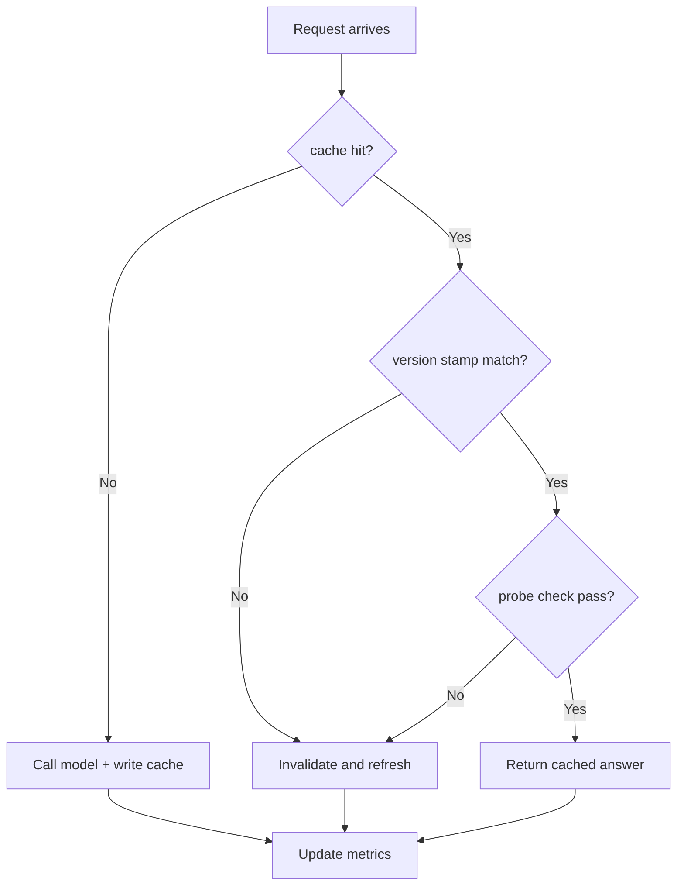
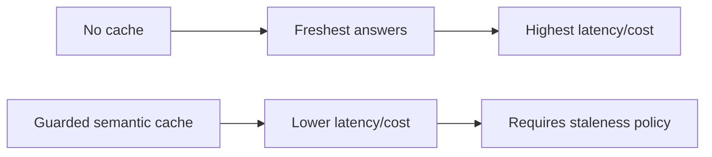
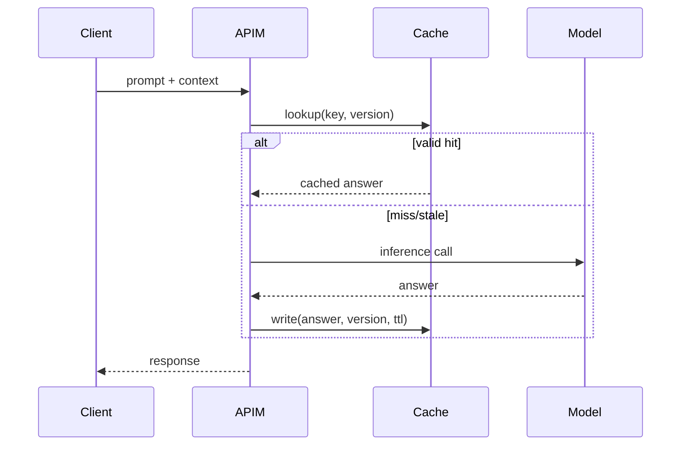

# Agent APIM LLM Cache Staleness Guard Selection FAQ (Azure AI Agent Infra)

## 1) 3-minute conclusions
- **Without staleness guards, APIM AI Gateway semantic cache can repeatedly serve outdated answers.**
- **Recommended: tiered TTL + source version stamp + lightweight hit-time probe.**
- **Targets: `stale_hit_rate <0.5%`, `cache_gain_p95 >120ms`, `false_fresh=0`.**

## 2) Q1 / Q2 / Q3
- **Why stale drift happens?** Upstream knowledge versions change while cache keys miss version semantics.
- **Why not disable cache entirely?** Latency and cost rise substantially.
- **Minimum loop?** Version stamps, delta probes, tiered TTL.

### Q1: When to force invalidation?
On version changes, policy updates, or failed post-hit probe.

### Q2: When to relax TTL?
Low-risk Q&A in stable version windows.

### Q3: How to evaluate gain?
Compare latency reduction versus stale hit rate.

## 3) Mermaid diagrams
### 3.1 Decision tree

### 3.2 Path comparison

### 3.3 Sequence

## 4) Decision matrix
| Dimension | No cache | Guarded cache (Recommended) |
|---|---:|---:|
| Latency | Lower score | Higher score |
| Cost | Lower score | Higher score |
| Staleness control | High (no hits) | High (guarded) |
| Ops complexity (1-10) | 3 | 7 |
| Scalability | Medium | High |

## 5) Quant model + 7-card insights
- Stale rate: `StaleRate = StaleHits / TotalHits`
- Gain: `LatencyGain = BaselineP95 - CachedP95`
- Example (`synthetic_assumed`):
  - `StaleHits=19, TotalHits=5,200`
  - `StaleRate=0.37%`
  - `BaselineP95=910ms, CachedP95=744ms`
  - `LatencyGain=166ms`
- Evidence:
  - `workshops/azure-agent-infra/evidence/cycle-1475-benchmark.json`
  - `workshops/azure-agent-infra/evidence/cycle-1475-sources.json`
- Labels: `official/synthetic_assumed/not_measured`.

## 6) Production verification checklist
- [ ] Keys include version stamp and policy tags
- [ ] Hit-time probe checks are replayable
- [ ] Tiered TTL policy is rollout/rollback ready
- [ ] stale-hit alerts are wired to actions
- [ ] FAQ/7-card source labels are complete
