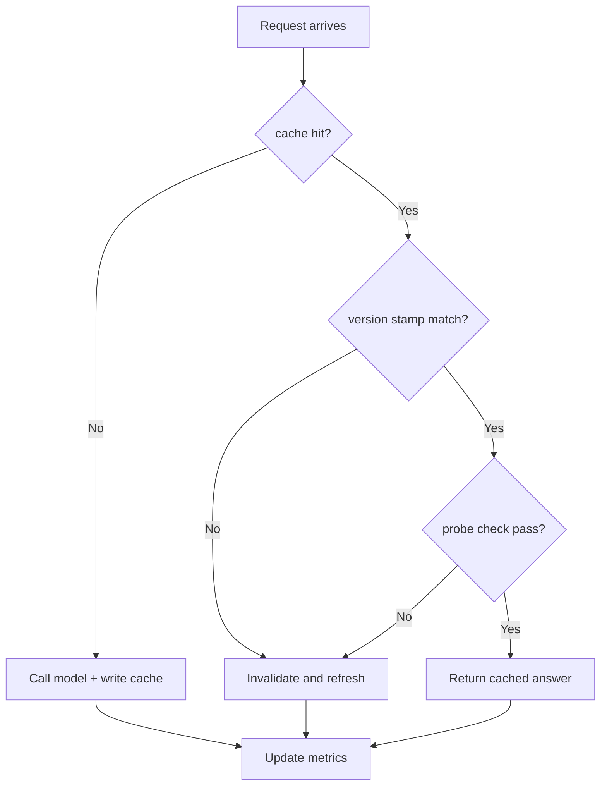
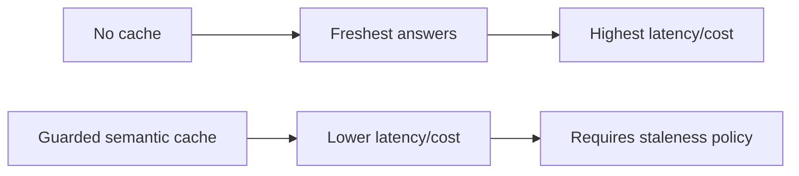
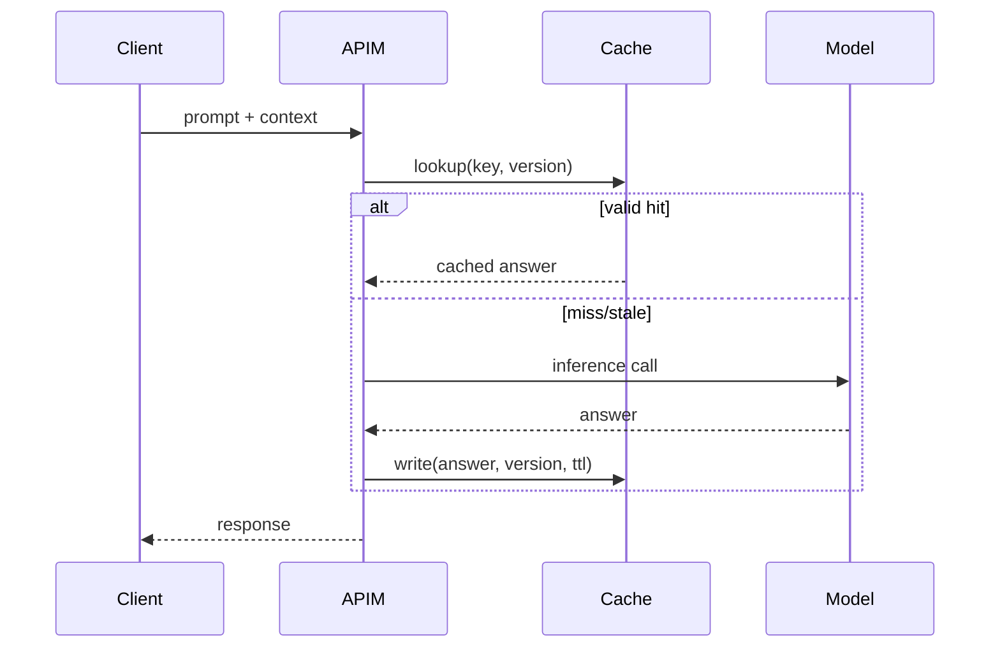

# Agent APIM LLM Cache Staleness Guard 选型 FAQ（Azure AI Agent Infra）

## 1) 3 分钟结论
- **APIM AI Gateway 语义缓存若缺乏陈旧性守卫，会导致错误答案稳定命中。**
- **推荐“TTL 分层 + 来源版本戳 + 命中后轻量校验”组合。**
- **目标阈值：`stale_hit_rate <0.5%`、`cache_gain_p95 >120ms`、`false_fresh=0`。**

## 2) Q1 / Q2 / Q3
- **为何缓存会过期失真？**：上游知识版本更新但 key 未含版本语义。
- **为何不能全禁缓存？**：延迟与成本显著上升。
- **最小闭环？**：版本戳、差异探针、分层 TTL。

### Q1：何时强制失效？
版本戳变化、政策更新、命中后探针失败时。

### Q2：何时放宽 TTL？
低风险问答且版本稳定期。

### Q3：如何评估收益？
比较延迟收益与陈旧命中率。

## 3) Mermaid 图
### 3.1 决策树

### 3.2 路径对比

### 3.3 时序

## 4) 决策矩阵
| 维度 | 无缓存 | 守卫缓存（推荐） |
|---|---:|---:|
| 延迟 | 低分 | 高分 |
| 成本 | 低分 | 高分 |
| 陈旧风险控制 | 高（无命中） | 高（守卫） |
| 运维复杂度（1-10） | 3 | 7 |
| 可扩展性 | 中 | 高 |

## 5) 定量算例与 7-Card 洞察
- 陈旧命中率：`StaleRate = StaleHits / TotalHits`
- 收益：`LatencyGain = BaselineP95 - CachedP95`
- 示例（`synthetic_assumed`）：
  - `StaleHits=19, TotalHits=5,200`
  - `StaleRate=0.37%`
  - `BaselineP95=910ms, CachedP95=744ms`
  - `LatencyGain=166ms`
- 证据：
  - `workshops/azure-agent-infra/evidence/cycle-1475-benchmark.json`
  - `workshops/azure-agent-infra/evidence/cycle-1475-sources.json`
- 标签：`official/synthetic_assumed/not_measured`。

## 6) 生产核验 Checklist
- [ ] key 维度含版本戳与策略标签
- [ ] 命中后探针校验可回放
- [ ] TTL 分层策略可灰度可回滚
- [ ] stale_hit 告警阈值已联动
- [ ] FAQ/7-Card 来源标签完整
