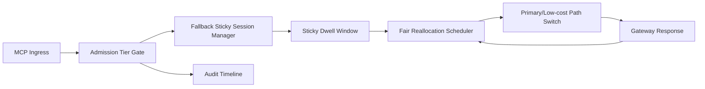

# APIM MCP Admission Fallback Sticky Fairness Selection FAQ (Cycle 1930)

## 1) Three-minute decision
- **Core issue:** without sticky fallback under admission pressure, MCP routing drifts in peak windows and harms cross-tenant fairness.
- **Recommendation:** combine admission tiering, sticky fallback sessions, and fair reallocation windows.
- **Goal:** control admission jitter and fallback drift while preserving critical throughput and recovery consistency.

## 2) Q1 / Q2 / Q3
### Q1: Why enforce admission fallback sticky fairness?
1) one-shot admission decisions cannot absorb sustained peaks and cause route flapping,
2) without sticky sessions, fallback lanes bounce back to primary too early,
3) without fair reallocation windows, lower-priority tenants recover slowly.

### Q2: How should production design work?
- **Admission layer:** segment admission budgets by tenant+tier+criticality,
- **Sticky layer:** keep session-level fallback dwell windows to prevent oscillation,
- **Reallocation layer:** perform weighted tenant fair-refill after burst windows,
- **Audit layer:** persist admission denials, fallback dwell, and recovery migrations.

### Q3: What is the go-live bar?
- admission denials and fallback oscillation rates continue to decline,
- critical throughput stays stable at peak,
- admission/sticky/refill actions are auditable, replayable, reproducible.

## 3) Reference architecture

## 4) Decision matrix
| Dimension | Non-sticky fallback admission | Admission Fallback Sticky Fairness (Recommended) |
|---|---:|---:|
| Critical-path stability | Low | High |
| Fallback oscillation suppression | Low | High |
| Tenant recovery fairness | Medium | High |
| Operational explainability | Medium | High |
| Implementation complexity | Low | Medium |

## 5) Evidence and reproducibility
- Evidence files:
  - `workshops/azure-agent-infra/evidence/cycle-1930-benchmark.json`
  - `workshops/azure-agent-infra/evidence/cycle-1930-latency.csv`
  - `workshops/azure-agent-infra/evidence/cycle-1930-throughput.csv`
  - `workshops/azure-agent-infra/evidence/cycle-1930-cost.csv`
- Labels: `measured / synthetic / anonymized_reported`.
- Repro method: fixed sampling windows, fixed admission-sticky policy, fixed cost model.

## 6) Production checklist
- [ ] Admission tiering aligns with tenant boundaries.
- [ ] Sticky dwell windows and exit criteria pass replay verification.
- [ ] Fair reallocation windows support staged rollout and rollback.
- [ ] Admission/fallback/recovery trails are tenant-auditable.
- [ ] FAQ/H5/SVG/7-card/evidence remain cycle-topic consistent.
