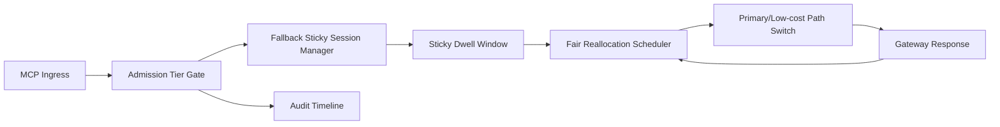

# APIM MCP 准入回退粘性公平选型 FAQ（Cycle 1930）

## 1) 3 分钟结论
- **核心问题：** MCP 请求在准入压力下若缺少回退粘性策略，路径会在高峰窗口频繁漂移并影响跨租户公平。
- **推荐方案：** “准入分层 + 回退粘性会话 + 公平再分配窗口”三层治理。
- **目标：** 控制准入抖动和回退漂移，稳定关键路径吞吐并提升租户恢复一致性。

## 2) Q1 / Q2 / Q3
### Q1：为什么要做 admission fallback sticky fairness？
1) 单次准入决策无法覆盖持续高峰，会导致频繁路径切换；
2) 无粘性会话时回退后容易再次抢占主路径形成抖振；
3) 无公平再分配窗口时低优先级租户恢复慢。

### Q2：生产级如何设计？
- **准入层：** 按 tenant+tier+criticality 划分准入预算；
- **粘性层：** 回退后维持会话级粘性驻留，避免抖振；
- **再分配层：** 在窗口结束后按租户权重执行公平回补；
- **审计层：** 记录准入拒绝、回退驻留、恢复迁移轨迹。

### Q3：上线判据是什么？
- 准入拒绝率与回退抖振率持续下降；
- 关键链路吞吐在峰值窗口保持平稳；
- 准入/粘性/回补动作可审计、可重放、可复算。

## 3) 架构图

## 4) 选型矩阵
| 维度 | 无粘性回退准入 | Admission Fallback Sticky Fairness（推荐） |
|---|---:|---:|
| 关键路径稳定性 | 低 | 高 |
| 回退抖振抑制 | 低 | 高 |
| 租户恢复公平性 | 中 | 高 |
| 运维可解释性 | 中 | 高 |
| 实施复杂度 | 低 | 中 |

## 5) 数据证据与可复算算例（含 n 分母来源）
- 证据文件：
  - `workshops/azure-agent-infra/evidence/cycle-1930-benchmark.json`
  - `workshops/azure-agent-infra/evidence/cycle-1930-latency.csv`
  - `workshops/azure-agent-infra/evidence/cycle-1930-throughput.csv`
  - `workshops/azure-agent-infra/evidence/cycle-1930-cost.csv`
- 标签：`measured / synthetic / anonymized_reported`。
- 口径：固定采样窗口、固定准入粘性策略、固定成本模型，可重复复算。

## 6) 生产检查清单
- [ ] 准入分层规则与租户边界一致。
- [ ] 回退粘性驻留时长与退出条件通过回放验证。
- [ ] 公平再分配窗口支持灰度开关与回滚。
- [ ] 准入/回退/恢复轨迹可按租户审计。
- [ ] FAQ/H5/SVG/7-card/evidence 的 cycle/topic 一致。
