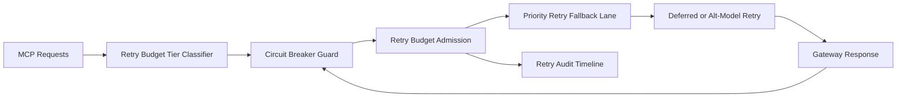

# APIM MCP Circuit Breaker Retry Budget Fairness Selection FAQ (Cycle 1922)

## 1) Three-minute decision
- **Core issue:** under failure spikes, globally shared retry budgets let non-critical retries starve critical chains and trigger timeout cascades.
- **Recommendation:** combine tiered retry budgeting, circuit-breaker gating, and priority retry fallback lanes.
- **Goal:** control retry-storm cost while preserving critical throughput and recovery stability.

## 2) Q1 / Q2 / Q3
### Q1: Why enforce retry-budget fairness?
1) global retry budgets amplify noisy-failure contention against critical chains,
2) without circuit-breaker gating, short failures induce retry storms,
3) without priority fallback, critical and non-critical requests degrade equally.

### Q2: How should production design work?
- **Tier layer:** partition retry budgets by tenant+tier+toolchain,
- **Gate layer:** use circuit-breaker state machine to limit retry on bad lanes,
- **Priority layer:** over-budget requests degrade via criticality-aware retry lanes,
- **Audit layer:** persist budget spend, breaker trips, and recovery traces.

### Q3: What is the go-live bar?
- lower retry-budget unfairness and timeout rates,
- stable critical throughput after breaker trips,
- replayable and auditable budget/breaker actions.

## 3) Reference architecture

## 4) Decision matrix
| Dimension | Global shared retry budget | Circuit Breaker Retry Budget Fairness (Recommended) |
|---|---:|---:|
| Critical path protection | Low | High |
| Peak stability | Medium | High |
| Retry cost control | Medium | High |
| Operational explainability | Medium | High |
| Implementation complexity | Low | Medium |

## 5) Evidence and reproducibility
- Evidence files:
  - `workshops/azure-agent-infra/evidence/cycle-1922-benchmark.json`
  - `workshops/azure-agent-infra/evidence/cycle-1922-latency.csv`
  - `workshops/azure-agent-infra/evidence/cycle-1922-throughput.csv`
  - `workshops/azure-agent-infra/evidence/cycle-1922-cost.csv`
- Labels: `measured / synthetic / anonymized_reported`.
- Repro method: fixed sampling window, fixed breaker/retry-budget policy, fixed cost model.

## 6) Production checklist
- [ ] Retry-budget tiering aligns with tenant boundaries.
- [ ] Circuit-breaker parameters pass historical replay verification.
- [ ] Priority retry fallback includes cooldown and rollback switches.
- [ ] Budget/breaker/recover trails are tenant-auditable.
- [ ] FAQ/H5/SVG/7-card/evidence remain cycle-topic consistent.
