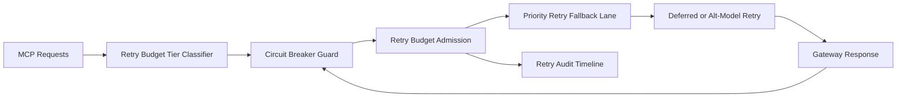

# APIM MCP Circuit Breaker Retry Budget Fairness 选型 FAQ（Cycle 1922）

## 1) 3 分钟结论
- **核心问题：** MCP 工具调用在异常峰值下若重试预算按全局共享，关键链路会被非关键重试挤占并触发雪崩超时。
- **推荐方案：** “重试预算分层 + 断路器门控 + 优先级回退重试”三层治理。
- **目标：** 控制重试风暴成本，同时保障关键路径吞吐与恢复稳定。

## 2) Q1 / Q2 / Q3
### Q1：为什么要做 retry budget fairness？
1) 全局重试预算会放大高频失败链路对关键链路的挤占；
2) 无断路器门控时，短时故障会引发重试风暴；
3) 无优先级回退时，关键与非关键请求同等退化。

### Q2：生产级如何设计？
- **分层层：** 按 tenant+tier+toolchain 划分重试预算；
- **门控层：** 使用断路器状态机限制异常链路重试；
- **优先级层：** 超预算时按关键级别降级重试路径；
- **审计层：** 记录预算消耗、断路触发与恢复轨迹。

### Q3：上线判据是什么？
- 重试预算不公平率与超时率持续下降；
- 断路器触发后关键链路吞吐保持稳定；
- 预算与断路动作可审计、可重放、可复算。

## 3) 架构图

## 4) 选型矩阵
| 维度 | 全局共享重试预算 | Circuit Breaker Retry Budget Fairness（推荐） |
|---|---:|---:|
| 关键路径保障 | 低 | 高 |
| 峰值稳定性 | 中 | 高 |
| 重试成本可控性 | 中 | 高 |
| 运维可解释性 | 中 | 高 |
| 实施复杂度 | 低 | 中 |

## 5) 证据与复算口径
- 证据文件：
  - `workshops/azure-agent-infra/evidence/cycle-1922-benchmark.json`
  - `workshops/azure-agent-infra/evidence/cycle-1922-latency.csv`
  - `workshops/azure-agent-infra/evidence/cycle-1922-throughput.csv`
  - `workshops/azure-agent-infra/evidence/cycle-1922-cost.csv`
- 标签：`measured / synthetic / anonymized_reported`。
- 口径：固定采样窗口、固定断路器与重试预算策略、固定成本模型，支持重复复算。

## 6) 生产检查清单
- [ ] 重试预算分层规则与租户边界一致。
- [ ] 断路器参数通过历史回放验证。
- [ ] 优先级重试回退具备冷却与回滚开关。
- [ ] 预算/断路/恢复轨迹可按租户审计。
- [ ] FAQ/H5/SVG/7-card/evidence 的 cycle/topic 一致。
