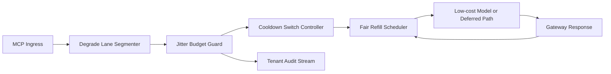

# APIM MCP Degrade Lane Jitter Fairness Selection FAQ (Cycle 1927)

## 1) Three-minute decision
- **Core issue:** during burst downgrade windows, uncontrolled degrade-lane jitter can spill cross-window latency drift into critical tenant paths.
- **Recommendation:** apply degrade-lane segmentation, jitter-budget thresholds, and fairness refill cadence.
- **Goal:** stabilize downgrade-path jitter while preserving tenant fairness and burst elasticity.

## 2) Q1 / Q2 / Q3
### Q1: Why enforce degrade-lane jitter fairness?
1) a single downgrade queue amplifies one-tenant jitter to global lanes,
2) without jitter thresholds, fallback decisions oscillate at window boundaries,
3) without fair refill, low-frequency tenants recover much slower.

### Q2: How should production design work?
- **Segment layer:** split downgrade lanes by tenant+tier+criticality,
- **Threshold layer:** set jitter budget and cooldown switches per lane,
- **Refill layer:** provide explainable fairness-recovery windows,
- **Audit layer:** persist downgrade triggers, jitter curves, and recovery traces.

### Q3: What is the go-live bar?
- downgrade-window jitter and timeout rates continue to decline,
- critical throughput avoids cliff effects under peak load,
- threshold and refill actions are replayable, auditable, and reproducible.

## 3) Reference architecture

## 4) Decision matrix
| Dimension | Unified downgrade queue | Degrade-Lane Jitter Fairness (Recommended) |
|---|---:|---:|
| Critical-path continuity | Low | High |
| Downgrade jitter control | Medium | High |
| Tenant recovery fairness | Medium | High |
| Operational explainability | Medium | High |
| Implementation complexity | Low | Medium |

## 5) Evidence and reproducibility
- Evidence files:
  - `workshops/azure-agent-infra/evidence/cycle-1927-benchmark.json`
  - `workshops/azure-agent-infra/evidence/cycle-1927-latency.csv`
  - `workshops/azure-agent-infra/evidence/cycle-1927-throughput.csv`
  - `workshops/azure-agent-infra/evidence/cycle-1927-cost.csv`
- Labels: `measured / synthetic / anonymized_reported`.
- Repro method: fixed sampling windows, fixed downgrade-jitter policy, fixed cost model.

## 6) Production checklist
- [ ] Degrade-lane segmentation matches tenant boundaries.
- [ ] Jitter-budget and cooldown parameters pass replay verification.
- [ ] Fair-refill windows support staged rollout and rollback.
- [ ] Downgrade/refill/recovery trails are tenant-auditable.
- [ ] FAQ/H5/SVG/7-card/evidence remain cycle-topic consistent.
