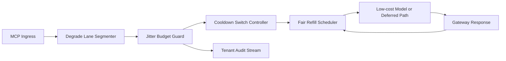

# APIM MCP 降档车道抖动公平选型 FAQ（Cycle 1927）

## 1) 3 分钟结论
- **核心问题：** MCP 网关在突发期触发降档后，如果降档车道抖动不可控，会让关键租户请求出现跨窗漂移。
- **推荐方案：** “降档车道分段 + 抖动预算门限 + 公平回补节奏”三段治理。
- **目标：** 稳定降档路径延迟抖动，同时保持租户级公平与吞吐弹性。

## 2) Q1 / Q2 / Q3
### Q1：为什么要做 degrade-lane jitter fairness？
1) 统一降档队列会把单租户峰值抖动扩散到全局；
2) 无抖动预算门限时，回退决策会在窗口边界反复震荡；
3) 无公平回补时，低频租户恢复速度显著落后。

### Q2：生产级应该怎么落地？
- **分段层：** 按 tenant+tier+criticality 切分降档车道；
- **门限层：** 为每条车道设置抖动预算与切换冷却；
- **回补层：** 对被降档租户提供可解释公平回补窗口；
- **审计层：** 记录降档触发、抖动曲线与恢复轨迹。

### Q3：何时判定可上线？
- 降档窗口抖动幅度与超时率持续下降；
- 关键链路吞吐在高峰时段无明显断崖；
- 抖动门限与回补动作可重放、可审计、可复算。

## 3) 架构图

## 4) 选型矩阵
| 维度 | 统一降档队列 | Degrade-Lane Jitter Fairness（推荐） |
|---|---:|---:|
| 关键请求连续性 | 低 | 高 |
| 降档抖动可控性 | 中 | 高 |
| 租户恢复公平性 | 中 | 高 |
| 运维可解释性 | 中 | 高 |
| 实施复杂度 | 低 | 中 |

## 5) 数据证据与可复算算例（含 n 分母来源）
- 证据文件：
  - `workshops/azure-agent-infra/evidence/cycle-1927-benchmark.json`
  - `workshops/azure-agent-infra/evidence/cycle-1927-latency.csv`
  - `workshops/azure-agent-infra/evidence/cycle-1927-throughput.csv`
  - `workshops/azure-agent-infra/evidence/cycle-1927-cost.csv`
- 标签：`measured / synthetic / anonymized_reported`。
- 口径：固定采样窗口、固定降档抖动门限策略、固定成本模型，可重复复算。

## 6) 生产检查清单
- [ ] 降档车道分段规则与租户边界一致。
- [ ] 抖动预算门限与冷却参数通过回放验证。
- [ ] 公平回补窗口支持灰度开关与回滚。
- [ ] 降档/回补/恢复轨迹可按租户审计。
- [ ] FAQ/H5/SVG/7-card/evidence 的 cycle/topic 一致。
