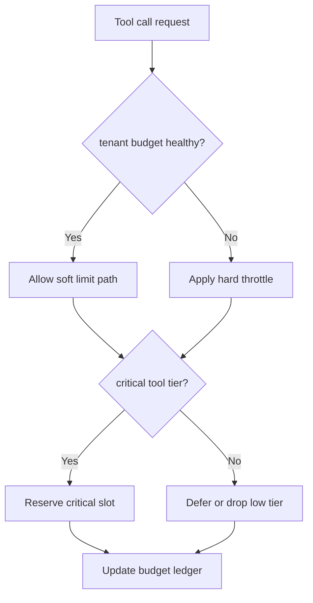
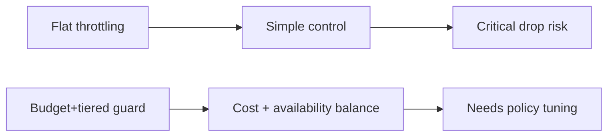
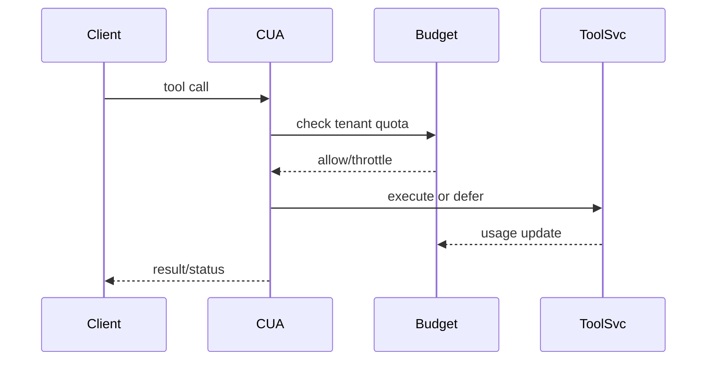

# Agent APIM MCP Drain Threshold Selection FAQ (Azure AI Agent Infra)

## 1) 3-minute conclusions
- **Without tool-call budget guards, Session traffic spikes can cause gateway overspend and queue stalls.**
- **Use tenant quota caps + tool-tier prioritization + soft/hard throttles.**
- **Targets: `tool_budget_overrun=0`, `queue_p95 <320ms`, `critical_tool_drop <0.2%`.**

## 2) Q1 / Q2 / Q3
- **Why overspend happens?** Retries and concurrency amplification exceed forecasts.
- **Why not one-size throttling?** Critical tools get dropped and business degrades.
- **Minimum loop?** Budget tiers, priority reservation, over-limit fallback.

### Q1: When to enter hard throttle?
When projected budget exhaustion crosses threshold.

### Q2: When to return to soft mode?
When budget recovers and queue stabilizes.

### Q3: How to measure gain?
Compare overrun rate, critical availability, and queue latency.

## 3) Mermaid diagrams
### 3.1 Decision tree

### 3.2 Path comparison

### 3.3 Sequence

## 4) Decision matrix
| Dimension | Flat throttling | Budget+tiered guard (Recommended) |
|---|---:|---:|
| Cost control | Medium | High |
| Critical availability | Medium | High |
| Ops complexity (1-10) | 4 | 8 |
| Queue stability | Medium | High |
| Scalability | Medium | High |

## 5) Quant model + 7-card insights
- Overrun rate: `Overrun = OverBudgetCalls / TotalCalls`
- Critical gain: `CriticalGain = BaselineCriticalDrop - GuardedCriticalDrop`
- Example (`synthetic_assumed`):
  - `OverBudgetCalls=0, TotalCalls=128,000`
  - `Overrun=0`
  - `BaselineCriticalDrop=0.9%, GuardedCriticalDrop=0.14%`
  - `CriticalGain=0.76%`
- Evidence:
  - `workshops/azure-agent-infra/evidence/cycle-1489-benchmark.json`
  - `workshops/azure-agent-infra/evidence/cycle-1489-sources.json`
- Labels: `official/synthetic_assumed/not_measured`.

## 6) Production verification checklist
- [ ] Tool-call budget ledger is auditable
- [ ] Critical-slot reservation policy is active
- [ ] Soft/hard throttle switch thresholds are replayable
- [ ] Queue latency and overrun alerts are linked
- [ ] FAQ/7-card source labels are complete
