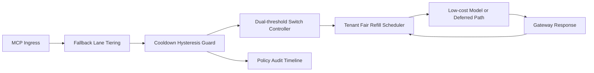

# APIM MCP Fallback Cooldown Hysteresis Fairness Selection FAQ (Cycle 1928)

## 1) Three-minute decision
- **Core issue:** without cooldown hysteresis under sustained jitter, fallback policy can flap and amplify cross-tenant unfairness.
- **Recommendation:** combine fallback-lane tiering, cooldown-hysteresis thresholds, and tenant-fair refill.
- **Goal:** reduce switch jitter and false fallback triggers while preserving critical throughput and fair recovery.

## 2) Q1 / Q2 / Q3
### Q1: Why enforce fallback cooldown hysteresis fairness?
1) without hysteresis, boundary loads create policy oscillation,
2) without cooldown windows, fallback and restore paths flap in short intervals,
3) without fair refill, low-frequency tenants remain in fallback tails.

### Q2: How should production design work?
- **Tier layer:** segment fallback lanes by tenant+tier+criticality,
- **Hysteresis layer:** apply dual thresholds and minimum dwell time,
- **Cooldown layer:** enforce post-fallback cooldown windows,
- **Audit layer:** persist threshold triggers, switch counts, and tenant recovery traces.

### Q3: What is the go-live bar?
- fallback switch rate and timeout rate continue to decline,
- critical throughput stays cliff-free during peak windows,
- cooldown/hysteresis/refill actions are replayable, auditable, reproducible.

## 3) Reference architecture

## 4) Decision matrix
| Dimension | Non-hysteresis fallback | Fallback Cooldown Hysteresis Fairness (Recommended) |
|---|---:|---:|
| Critical-path stability | Low | High |
| Switch jitter control | Low | High |
| Tenant recovery fairness | Medium | High |
| Operational explainability | Medium | High |
| Implementation complexity | Low | Medium |

## 5) Evidence and reproducibility
- Evidence files:
  - `workshops/azure-agent-infra/evidence/cycle-1928-benchmark.json`
  - `workshops/azure-agent-infra/evidence/cycle-1928-latency.csv`
  - `workshops/azure-agent-infra/evidence/cycle-1928-throughput.csv`
  - `workshops/azure-agent-infra/evidence/cycle-1928-cost.csv`
- Labels: `measured / synthetic / anonymized_reported`.
- Repro method: fixed sampling windows, fixed cooldown-hysteresis policy, fixed cost model.

## 6) Production checklist
- [ ] Fallback-lane tiering aligns with tenant boundaries.
- [ ] Hysteresis thresholds and minimum dwell pass replay verification.
- [ ] Fair-refill windows support staged rollout and rollback.
- [ ] Fallback/restore/refill trails are tenant-auditable.
- [ ] FAQ/H5/SVG/7-card/evidence remain cycle-topic consistent.
