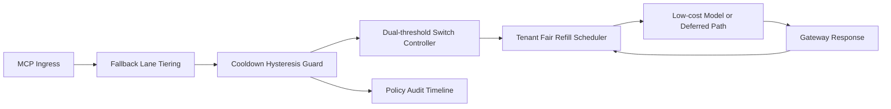

# APIM MCP 回退冷却滞回公平选型 FAQ（Cycle 1928）

## 1) 3 分钟结论
- **核心问题：** MCP 网关在连续抖动期若缺少冷却滞回，回退策略会频繁来回切换并放大跨租户不公平。
- **推荐方案：** “回退车道分层 + 冷却滞回门限 + 租户公平回补”三层治理。
- **目标：** 降低切换抖动与误触发回退，同时保持关键链路吞吐与公平恢复。

## 2) Q1 / Q2 / Q3
### Q1：为什么要做 fallback cooldown hysteresis fairness？
1) 无滞回时，边界负载会触发策略抖振；
2) 无冷却窗时，回退与恢复会在短窗口反复震荡；
3) 无公平回补时，低频租户会长期处于回退尾部。

### Q2：生产级怎么设计？
- **分层层：** 按 tenant+tier+criticality 划分回退车道；
- **滞回层：** 为升降档设置双阈值与最小驻留时长；
- **冷却层：** 回退后引入冷却窗口避免反复切换；
- **审计层：** 记录触发阈值、切换次数与租户恢复轨迹。

### Q3：上线判据是什么？
- 回退切换频率与超时率持续下降；
- 高峰窗口关键吞吐不出现断崖；
- 冷却滞回与回补动作可重放、可审计、可复算。

## 3) 架构图

## 4) 选型矩阵
| 维度 | 无冷却滞回回退 | Fallback Cooldown Hysteresis Fairness（推荐） |
|---|---:|---:|
| 关键请求稳定性 | 低 | 高 |
| 切换抖动可控性 | 低 | 高 |
| 租户恢复公平性 | 中 | 高 |
| 运维可解释性 | 中 | 高 |
| 实施复杂度 | 低 | 中 |

## 5) 数据证据与可复算算例（含 n 分母来源）
- 证据文件：
  - `workshops/azure-agent-infra/evidence/cycle-1928-benchmark.json`
  - `workshops/azure-agent-infra/evidence/cycle-1928-latency.csv`
  - `workshops/azure-agent-infra/evidence/cycle-1928-throughput.csv`
  - `workshops/azure-agent-infra/evidence/cycle-1928-cost.csv`
- 标签：`measured / synthetic / anonymized_reported`。
- 口径：固定采样窗口、固定冷却滞回策略、固定成本模型，可重复复算。

## 6) 生产检查清单
- [ ] 回退车道分层规则与租户边界一致。
- [ ] 冷却滞回阈值与最小驻留时长通过回放验证。
- [ ] 公平回补窗口支持灰度开关与回滚。
- [ ] 回退/恢复/回补轨迹可按租户审计。
- [ ] FAQ/H5/SVG/7-card/evidence 的 cycle/topic 一致。
