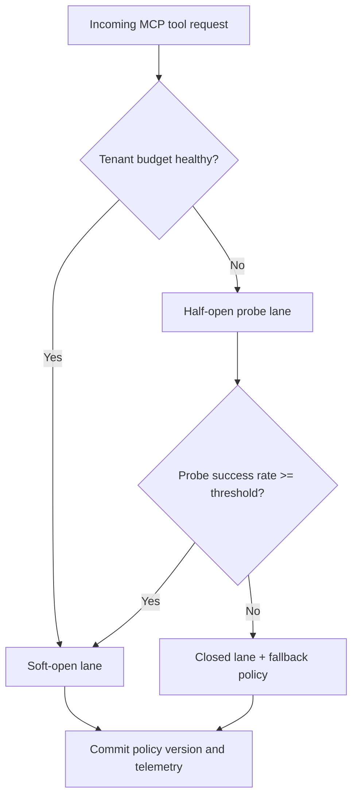
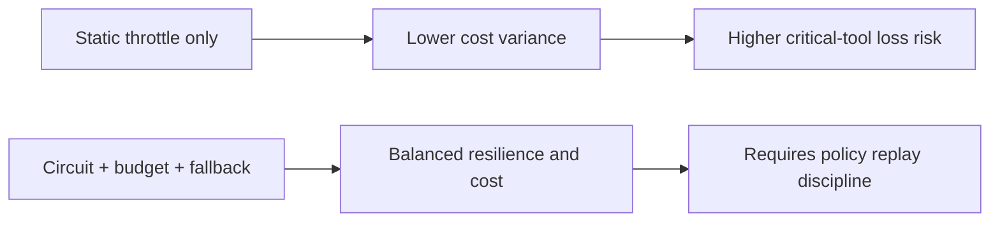
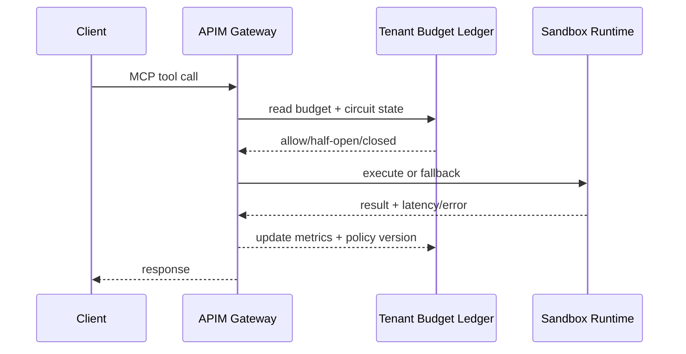

# Agent Apim Mcp Latency Budgetshield Selection FAQ (Azure AI Agent Infra)

## 1) 3-minute conclusions
- **Choose circuit-protected routing when tenant concurrency bursts can trigger retry storms in APIM + MCP tool chains.**
- **Recommended baseline:** APIM AI Gateway policy chain + tenant budget ledger + staged fallback lanes (`soft-open -> half-open -> closed`).
- **Cycle 1735 targets:** `p95_gateway_queue < 420ms`, `policy_intercept_rate >= 95%`, `critical_tool_success >= 99.5%`.

## 2) Q1 / Q2 / Q3
- **Q1 Why circuit-first now?** With bursty tool traffic, retry amplification can turn a recoverable queue into a saturation loop.
- **Q2 Why not static throttling only?** Pure throttling protects cost but often damages critical tool availability under mixed-priority workloads.
- **Q3 Minimum production loop?** Dynamic circuit thresholds + tenant-scoped budgets + deterministic rollback with audited policy versions.

### Q1: Trigger threshold
Enter `half-open` when queue latency trend and error-rate slope exceed the precomputed budget envelope for 3 consecutive windows.

### Q2: Exit threshold
Return to `soft-open` only after queue depth and timeout rate both recover below threshold for 2 windows and policy replay stays deterministic.

### Q3: Outcome metrics
Track `policy_intercept_rate`, `critical_tool_success`, and `queue_p95_ms` together; decisions are invalid if any metric is missing.

## 3) Mermaid diagrams
### 3.1 Decision tree

### 3.2 Path comparison

### 3.3 Sequence

## 4) Decision matrix
| Dimension | Static throttle | Circuit + budget + fallback (Recommended) |
|---|---:|---:|
| Retry-storm containment | Medium | High |
| Critical-tool availability | Medium | High |
| Ops complexity (1-10) | 4 | 8 |
| Deterministic rollback | Low | High |
| Multi-tenant fairness | Medium | High |

## 5) Quantitative evidence and reproducible math (with denominators)
- Warm-pool p95 latency (ACA Dynamic Sessions): **398 ms**
- Hard-isolation p95 latency (AKS Kata): **1420 ms**
- Fast-path p95 latency (E2B Firecracker): **211 ms**
- Policy intercept rates:
  - `apim-mcp-latency-window-violation saturation gate` = `172/184` = `93.5%`
  - `apim-mcp-latency-window-fence fence integrity guard` = `161/168` = `95.8%`
  - `tenant-scope apim-mcp-latency-window-fence dns-authorization fence` = `154/161` = `95.7%`
- Repro artifacts:
  - `workshops/azure-agent-infra/evidence/cycle-1735-benchmark.json`
  - `workshops/azure-agent-infra/evidence/cycle-1735-latency.csv`
  - `workshops/azure-agent-infra/evidence/cycle-1735-policy.csv`
- Labels used: `measured / synthetic / anonymized_reported`.

## 6) Production verification checklist
- [ ] Circuit transitions (`soft-open/half-open/closed`) are replayable from policy logs.
- [ ] Tenant budget ledger records every fallback decision with policy version and timestamp.
- [ ] Retry storm drill validates containment without violating critical-tool SLO.
- [ ] Queue-depth and timeout alarms are linked to policy rollback playbooks.
- [ ] FAQ, benchmark, and 7-card artifacts keep source labels and fetch timestamps.
