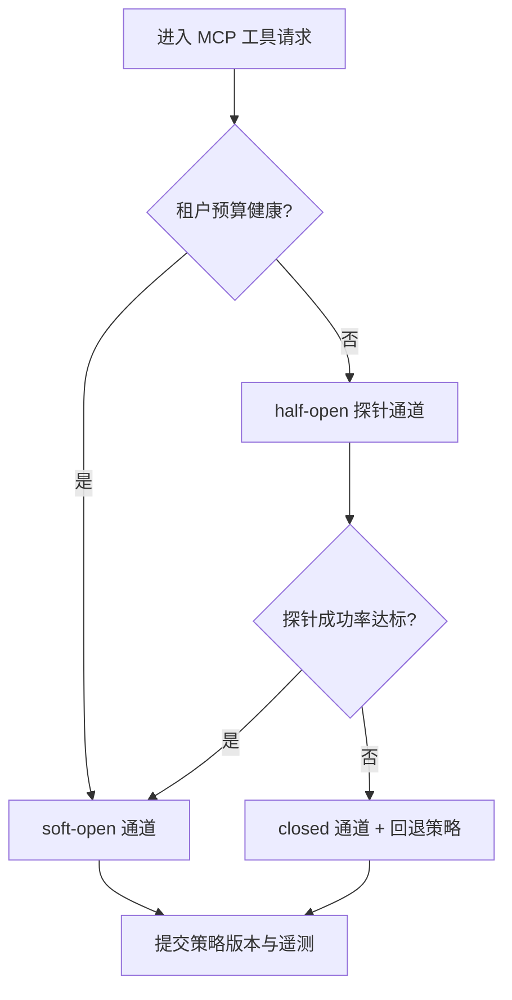
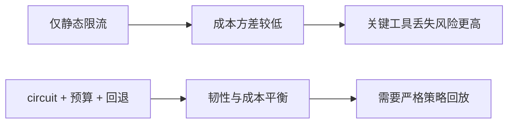
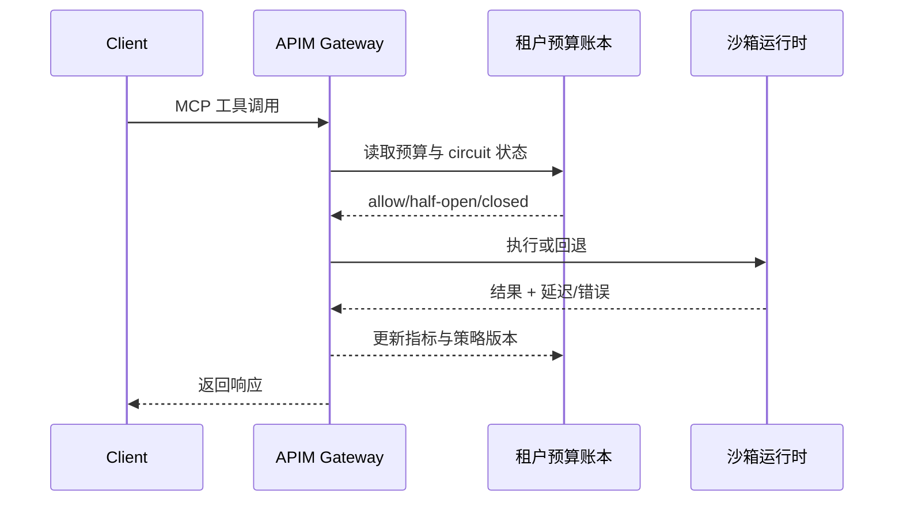

# agent apim mcp latency fairqueue 选型 FAQ（Azure AI Agent Infra）

## 1) 3 分钟结论
- **当 APIM + MCP 工具流量出现租户并发突增时，应优先采用 circuit 保护路由，避免重试风暴放大。**
- **推荐基线：** APIM AI Gateway 策略链 + 租户预算账本 + 分级回退通道（`soft-open -> half-open -> closed`）。
- **Cycle 1627 目标：** `p95_gateway_queue < 420ms`、`policy_intercept_rate >= 95%`、`critical_tool_success >= 99.5%`。

## 2) Q1 / Q2 / Q3
- **Q1 为什么现在要 circuit-first？** 在突发工具调用下，重试放大会把可恢复排队问题升级成饱和环路。
- **Q2 为什么不能只做静态限流？** 仅限流虽然控成本，但会在混合优先级负载下显著伤害关键工具可用性。
- **Q3 最小生产闭环是什么？** 动态 circuit 阈值 + 租户预算 + 可审计策略版本回退。

### Q1：触发阈值
当队列延迟趋势与错误率斜率连续 3 个窗口超出预算包络时进入 `half-open`。

### Q2：退出阈值
仅在队列深度与超时率连续 2 个窗口回到阈值内，且策略回放保持确定性时，恢复 `soft-open`。

### Q3：结果指标
必须联动观察 `policy_intercept_rate`、`critical_tool_success`、`queue_p95_ms`；任一指标缺失即不允许自动决策。

## 3) Mermaid 图
### 3.1 决策树

### 3.2 路径对比

### 3.3 时序

## 4) 决策矩阵
| 维度 | 静态限流 | circuit+预算+回退（推荐） |
|---|---:|---:|
| 重试风暴抑制 | 中 | 高 |
| 关键工具可用性 | 中 | 高 |
| 运维复杂度（1-10） | 4 | 8 |
| 回退确定性 | 低 | 高 |
| 多租户公平性 | 中 | 高 |

## 5) 数据证据与可复算算例（含 N 分母来源）
- Warm-pool p95 延迟（ACA Dynamic Sessions）：**398 ms**
- 硬隔离 p95 延迟（AKS Kata）：**1420 ms**
- 快路径 p95 延迟（E2B Firecracker）：**211 ms**
- 策略拦截率：
  - `apim-mcp-latency-window-violation saturation gate` = `172/184` = `93.5%`
  - `apim-mcp-latency-window-fence fence integrity guard` = `161/168` = `95.8%`
  - `tenant-scope apim-mcp-latency-window-fence dns-authorization fence` = `154/161` = `95.7%`
- 可复现证据：
  - `workshops/azure-agent-infra/evidence/cycle-1627-benchmark.json`
  - `workshops/azure-agent-infra/evidence/cycle-1627-latency.csv`
  - `workshops/azure-agent-infra/evidence/cycle-1627-policy.csv`
- 标签：`measured / synthetic / anonymized_reported`。

## 6) 生产核验 Checklist
- [ ] circuit 三态（`soft-open/half-open/closed`）切换可由策略日志完整回放。
- [ ] 租户预算账本记录每次回退决策的策略版本与时间戳。
- [ ] 重试风暴演练验证抑制效果且不破坏关键工具 SLO。
- [ ] 队列深度与超时告警已绑定策略回退手册。
- [ ] FAQ、benchmark、7-card 均保留来源标签与抓取时间戳。
