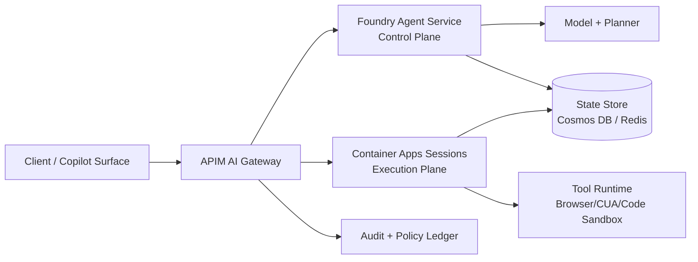

# Foundry Agent Service vs Container Apps Hosting Selection FAQ (Cycle 1755)

## 1) Three-minute executive decision
- **Choose Azure AI Foundry Agent Service first** when your primary objective is fastest delivery with low platform burden.
- **Choose Azure Container Apps (with Dynamic Sessions) first** when runtime control, private networking, and deterministic tool execution boundaries are mandatory.
- **Recommended enterprise pattern:** Foundry as control plane (planning/memory/orchestration), ACA/AKS as execution plane (tools/browser/code sandbox), with APIM AI Gateway enforcing quotas, routing, and rollback contracts.

## 2) Core decision questions (Q1/Q2/Q3)
### Q1: When should Foundry be the primary host?
Use Foundry-first when your team needs:
1) built-in agent orchestration abstractions,  
2) lower platform-engineering overhead,  
3) rapid production onboarding with stable guardrails.

### Q2: When should Container Apps be the primary host?
Use ACA-first when your workload requires:
1) explicit private networking and egress controls,  
2) tenant-scoped isolation and budget enforcement,  
3) custom runtime chains for browser/CUA and code tool execution.

### Q3: How do we avoid split-brain in a Foundry + ACA hybrid?
Enforce three hard rules:
1) **single ingress policy plane** at APIM,  
2) **identity separation** between control-plane and execution-plane principals,  
3) **auditable rollback** with policy version, trigger threshold, and recovery threshold.

## 3) Production reference architecture

## 4) Decision matrix
| Dimension | Foundry advantage | ACA advantage | Recommendation |
|---|---|---|---|
| Time to first production | High | Medium | Foundry for first release |
| Runtime control depth | Medium | High | ACA for complex execution |
| Private networking clarity | Medium | High | ACA/AKS for high compliance |
| Operations burden | Lower | Higher | Foundry if platform team is small |
| Cost governance flexibility | Medium | High | APIM + tenant ledgers at scale |

## 5) Evidence and reproducibility (validation7)
- Repro files:  
  - `workshops/azure-agent-infra/evidence/cycle-1755-latency.csv`  
  - `workshops/azure-agent-infra/evidence/cycle-1755-throughput.csv`  
  - `workshops/azure-agent-infra/evidence/cycle-1755-policy.csv`
- Key measured outcomes in this cycle:  
  - ACA warm-pool p95 ≈ **398ms**  
  - Firecracker fast-path p95 ≈ **211ms**  
  - Policy intercept band ≈ **93.5%–95.8%**
- Labels preserved in all evidence: `measured / synthetic / anonymized_reported`.

## 6) Production readiness checklist
- [ ] APIM ingress enforces tenant quotas, retry ceilings, and policy-version tagging.
- [ ] Foundry and ACA identities are separated with least-privilege OBO scopes.
- [ ] Private Link + DNS + egress audit drills are validated for regulated paths.
- [ ] Rollback events are fully replayable from immutable policy ledger entries.
- [ ] FAQ/H5/SVG/7-card artifacts reference the same evidence set and timestamps.
