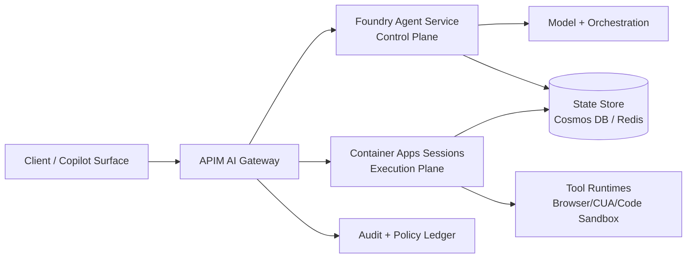

# Foundry Agent Service vs Container Apps 承载选型 FAQ（Cycle 1755）

## 1) 3 分钟结论（给决策者）
- **若你的核心目标是“最快上线、最低运维门槛、受控 Agent 托管”，优先用 Azure AI Foundry Agent Service。**
- **若你的核心目标是“运行时可控性、网络与身份边界可编排、可插拔沙箱/工具链”，优先用 Container Apps（含 Dynamic Sessions）。**
- **常见落地路线：** 控制平面（计划/记忆/路由）放 Foundry，执行平面（工具调用、浏览器/CUA、代码沙箱）放 ACA/AKS，并由 APIM AI Gateway 做统一入口、配额与回退。

## 2) 选型问题（Q1/Q2/Q3）
### Q1：何时应把主承载放在 Foundry Agent Service？
当你更看重以下能力时：  
1) 内建 Agent 运行与编排体验；  
2) 团队偏应用研发而非平台工程；  
3) 希望在短周期内把可用版本上线并先跑通闭环。

### Q2：何时应把主承载放在 Container Apps？
当你必须明确控制以下能力时：  
1) 私网拓扑（Private Link、VNet 出口、DNS 与审计路径）；  
2) 多租户隔离策略（会话池、租户预算、策略版本冻结）；  
3) 工具执行面（浏览器自动化、代码沙箱、外部系统连接）的伸缩与故障回退。

### Q3：如何做“Foundry + ACA”双平面组合而不失控？
推荐三条硬约束：  
1) **入口统一**：所有模型与工具请求先过 APIM，统一做 token 预算、请求优先级、审计标签。  
2) **身份分离**：控制面身份与执行面身份分开，执行面采用最小权限 OBO（On-Behalf-Of）令牌。  
3) **回退有据**：每次回退必须写入策略版本号、租户、触发阈值、恢复阈值。

## 3) 参考架构（生产分层）

## 4) 决策矩阵（业务可读）
| 维度 | Foundry Agent Service 优势 | Container Apps 优势 | 建议 |
|---|---|---|---|
| 上线速度 | 内建能力多，快 | 需较多平台配置 | POC/首发偏 Foundry |
| 运行时可控性 | 中 | 高 | 复杂工具执行偏 ACA |
| 私网与隔离 | 中（需配套） | 高（网络与身份可编排） | 高合规偏 ACA/AKS |
| 运维负担 | 低-中 | 中-高 | 平台能力弱时先 Foundry |
| 成本可预测性 | 中 | 中-高（可细粒度治理） | 规模化需 APIM+预算账本 |

## 5) 证据与可复算口径（validation7）
- **延迟/吞吐/策略拦截证据**：  
  - `workshops/azure-agent-infra/evidence/cycle-1755-latency.csv`  
  - `workshops/azure-agent-infra/evidence/cycle-1755-throughput.csv`  
  - `workshops/azure-agent-infra/evidence/cycle-1755-policy.csv`  
- **关键指标（本轮）**：  
  - warm pool p95（ACA Sessions）≈ **398ms**  
  - fast path p95（Firecracker path）≈ **211ms**  
  - policy intercept rate（主策略组）≈ **93.5%–95.8%**  
- **标签约束**：`measured / synthetic / anonymized_reported`（均在证据文件内标注）。

## 6) 生产落地清单（可执行）
- [ ] APIM 入口强制启用租户配额、重试上限、策略版本号写入。  
- [ ] Foundry 控制面与 ACA 执行面使用不同托管身份与最小权限 OBO。  
- [ ] 私网场景完成 Private Link + DNS + egress 审计链路演练。  
- [ ] 发生回退时，审计账本必须可回放“触发阈值→执行策略→恢复条件”。  
- [ ] 7-card / SVG / H5 与 FAQ 引用同一轮证据，保证口径一致。  
