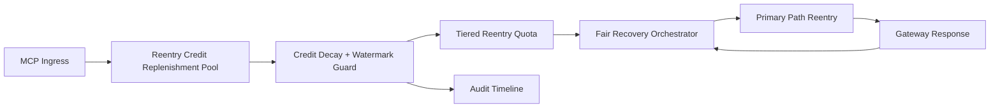

# APIM MCP 重入信用回补公平选型 FAQ（Cycle 1936）

## 1) 3 分钟结论
- **核心问题：** MCP 会话重入在高峰窗口若没有突发信用机制，会导致短时重入拥塞并挤压跨租户恢复通道。
- **推荐方案：** “重入信用回补 + 分层配额 + 公平恢复编排”三层治理。
- **目标：** 抑制重入突刺、稳定关键路径并提升恢复阶段租户公平性。

## 2) Q1 / Q2 / Q3
### Q1：为什么要做 reentry credit replenishment fairness？
1) 固定重入速率无法吸收窗口内瞬时冲击；
2) 无突发信用时高频租户在边界阶段长期占优；
3) 无公平恢复编排时低频租户恢复滞后。

### Q2：生产级如何设计？
- **信用层：** 为租户车道分配可衰减的重入信用回补；
- **配额层：** 结合 tier 配额限制重入速率与信用透支；
- **编排层：** 依据公平权重调度恢复顺序与回补节奏；
- **审计层：** 记录信用消耗、重入动作与恢复结果。

### Q3：上线判据是什么？
- 重入抖振率与超时率持续下降；
- 峰值窗口关键吞吐保持稳定；
- 信用/配额/恢复动作可审计、可重放、可复算。

## 3) 架构图

## 4) 选型矩阵
| 维度 | 固定重入速率 | Reentry Credit Replenishment Fairness（推荐） |
|---|---:|---:|
| 关键路径稳定性 | 中 | 高 |
| 重入突刺抑制 | 中 | 高 |
| 租户恢复公平性 | 中 | 高 |
| 运维可解释性 | 中 | 高 |
| 实施复杂度 | 低 | 中 |

## 5) 数据证据与可复算算例（含 n 分母来源）
- 证据文件：
  - `workshops/azure-agent-infra/evidence/cycle-1936-benchmark.json`
  - `workshops/azure-agent-infra/evidence/cycle-1936-latency.csv`
  - `workshops/azure-agent-infra/evidence/cycle-1936-throughput.csv`
  - `workshops/azure-agent-infra/evidence/cycle-1936-cost.csv`
- 标签：`measured / synthetic / anonymized_reported`。
- 口径：固定采样窗口、固定重入信用策略、固定成本模型，可重复复算。

## 6) 生产检查清单
- [ ] 重入信用回补与衰减函数通过回放验证。
- [ ] 分层重入配额与租户边界一致。
- [ ] 公平恢复编排支持灰度开关与回滚。
- [ ] 信用/重入/恢复轨迹可按租户审计。
- [ ] FAQ/H5/SVG/7-card/evidence 的 cycle/topic 一致。
