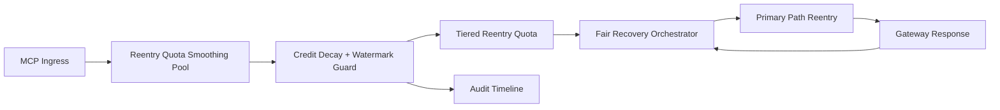

# APIM MCP Reentry Quota Smoothing Fairness Selection FAQ (Cycle 1937)

## 1) Three-minute decision
- **Core issue:** without quota-smoothing controls, reentry traffic creates short spikes that squeeze cross-tenant recovery channels.
- **Recommendation:** combine reentry quota smoothing, tiered quotas, and fair recovery orchestration.
- **Goal:** suppress reentry spikes, stabilize critical paths, and improve tenant fairness during recovery.

## 2) Q1 / Q2 / Q3
### Q1: Why enforce reentry quota smoothing fairness?
1) fixed reentry rates cannot absorb in-window spikes,
2) without burst credits, high-frequency tenants dominate at window boundaries,
3) without fair orchestration, low-frequency tenants recover slower.

### Q2: How should production design work?
- **Credit layer:** assign decaying reentry quota smoothing per tenant lane,
- **Quota layer:** enforce tier quotas and cap credit overdraft rates,
- **Orchestration layer:** schedule recovery by fairness weight and refill cadence,
- **Audit layer:** persist credit spend, reentry actions, and recovery outcomes.

### Q3: What is the go-live bar?
- reentry oscillation and timeout rates continue to decline,
- critical throughput stays stable at peak,
- credit/quota/recovery actions are auditable, replayable, reproducible.

## 3) Reference architecture

## 4) Decision matrix
| Dimension | Fixed reentry rate | Reentry Quota Smoothing Fairness (Recommended) |
|---|---:|---:|
| Critical-path stability | Medium | High |
| Reentry spike suppression | Medium | High |
| Tenant recovery fairness | Medium | High |
| Operational explainability | Medium | High |
| Implementation complexity | Low | Medium |

## 5) Evidence and reproducibility
- Evidence files:
  - `workshops/azure-agent-infra/evidence/cycle-1937-benchmark.json`
  - `workshops/azure-agent-infra/evidence/cycle-1937-latency.csv`
  - `workshops/azure-agent-infra/evidence/cycle-1937-throughput.csv`
  - `workshops/azure-agent-infra/evidence/cycle-1937-cost.csv`
- Labels: `measured / synthetic / anonymized_reported`.
- Repro method: fixed sampling windows, fixed quota-smoothing policy, fixed cost model.

## 6) Production checklist
- [ ] Reentry burst credits and decay function pass replay verification.
- [ ] Tiered reentry quotas align with tenant boundaries.
- [ ] Fair recovery orchestration supports staged rollout and rollback.
- [ ] Credit/reentry/recovery trails are tenant-auditable.
- [ ] FAQ/H5/SVG/7-card/evidence remain cycle-topic consistent.
