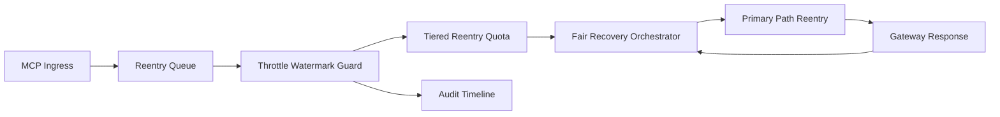

# APIM MCP Reentry Throttle Watermark Fairness Selection FAQ (Cycle 1934)

## 1) Three-minute decision
- **Core issue:** if reentry relies on fixed tokens without watermark throttling, peak windows create bursts that squeeze cross-tenant recovery channels.
- **Recommendation:** combine reentry throttle watermarks, tiered quotas, and fair recovery orchestration.
- **Goal:** suppress reentry bursts and watermark violations while preserving critical-path stability and recovery fairness.

## 2) Q1 / Q2 / Q3
### Q1: Why enforce reentry throttle watermark fairness?
1) fixed rates still produce bursty reentry at peak boundaries,
2) without watermarks, reentry queues crowd out primary recovery,
3) without fair orchestration, long-tail tenants recover slower.

### Q2: How should production design work?
- **Watermark layer:** set high/low watermark thresholds on reentry queues,
- **Quota layer:** assign tenant+tier reentry rates and burst budgets,
- **Orchestration layer:** schedule recovery order by fairness weights,
- **Audit layer:** persist watermark hits, throttle actions, and recovery traces.

### Q3: What is the go-live bar?
- reentry oscillation and timeout rates continue to decline,
- critical throughput remains stable at peak,
- watermark/quota/recovery actions are auditable, replayable, reproducible.

## 3) Reference architecture

## 4) Decision matrix
| Dimension | Fixed reentry rate | Reentry Throttle Watermark Fairness (Recommended) |
|---|---:|---:|
| Critical-path stability | Medium | High |
| Reentry burst suppression | Low | High |
| Tenant recovery fairness | Medium | High |
| Operational explainability | Medium | High |
| Implementation complexity | Low | Medium |

## 5) Evidence and reproducibility
- Evidence files:
  - `workshops/azure-agent-infra/evidence/cycle-1934-benchmark.json`
  - `workshops/azure-agent-infra/evidence/cycle-1934-latency.csv`
  - `workshops/azure-agent-infra/evidence/cycle-1934-throughput.csv`
  - `workshops/azure-agent-infra/evidence/cycle-1934-cost.csv`
- Labels: `measured / synthetic / anonymized_reported`.
- Repro method: fixed sampling windows, fixed watermark-throttle policy, fixed cost model.

## 6) Production checklist
- [ ] Reentry watermark thresholds and throttle actions pass replay verification.
- [ ] Tiered reentry quotas align with tenant boundaries.
- [ ] Fair recovery orchestration supports staged rollout and rollback.
- [ ] Watermark/reentry/recovery trails are tenant-auditable.
- [ ] FAQ/H5/SVG/7-card/evidence remain cycle-topic consistent.
