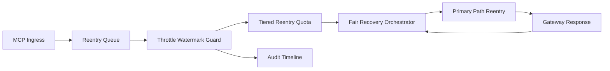

# APIM MCP 重入限流水位公平选型 FAQ（Cycle 1934）

## 1) 3 分钟结论
- **核心问题：** MCP 会话重入若只按固定令牌而无水位限流，会在峰值时段形成突刺并挤占跨租户恢复通道。
- **推荐方案：** “重入限流水位 + 分层配额 + 公平恢复编排”三层治理。
- **目标：** 抑制重入突刺与水位越界，稳定关键路径并提升恢复阶段公平性。

## 2) Q1 / Q2 / Q3
### Q1：为什么要做 reentry throttle watermark fairness？
1) 固定速率会在高峰边界触发短时重入冲击；
2) 无水位门限时重入队列会挤压主路径恢复；
3) 无公平恢复编排时长尾租户恢复滞后。

### Q2：生产级如何设计？
- **水位层：** 为重入队列设置高/低水位限流阈值；
- **配额层：** 按 tenant+tier 分配重入速率与突发额度；
- **编排层：** 按公平权重推进恢复顺序与带宽回补；
- **审计层：** 记录水位命中、限流动作与恢复轨迹。

### Q3：上线判据是什么？
- 重入抖振率与超时率持续下降；
- 峰值窗口关键吞吐保持稳定；
- 水位/配额/恢复动作可审计、可重放、可复算。

## 3) 架构图

## 4) 选型矩阵
| 维度 | 固定重入速率 | Reentry Throttle Watermark Fairness（推荐） |
|---|---:|---:|
| 关键路径稳定性 | 中 | 高 |
| 重入突刺抑制 | 低 | 高 |
| 租户恢复公平性 | 中 | 高 |
| 运维可解释性 | 中 | 高 |
| 实施复杂度 | 低 | 中 |

## 5) 数据证据与可复算算例（含 n 分母来源）
- 证据文件：
  - `workshops/azure-agent-infra/evidence/cycle-1934-benchmark.json`
  - `workshops/azure-agent-infra/evidence/cycle-1934-latency.csv`
  - `workshops/azure-agent-infra/evidence/cycle-1934-throughput.csv`
  - `workshops/azure-agent-infra/evidence/cycle-1934-cost.csv`
- 标签：`measured / synthetic / anonymized_reported`。
- 口径：固定采样窗口、固定重入水位策略、固定成本模型，可重复复算。

## 6) 生产检查清单
- [ ] 重入水位高低阈值与限流动作通过回放验证。
- [ ] 分层重入配额与租户边界一致。
- [ ] 公平恢复编排支持灰度开关与回滚。
- [ ] 水位/重入/恢复轨迹可按租户审计。
- [ ] FAQ/H5/SVG/7-card/evidence 的 cycle/topic 一致。
