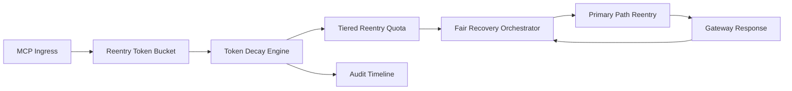

# APIM MCP Reentry Token Decay Fairness Selection FAQ (Cycle 1933)

## 1) Three-minute decision
- **Core issue:** without token decay for reentry, high-frequency tenants keep occupying recovery channels and amplify cross-tenant unfairness.
- **Recommendation:** combine reentry token decay, tiered quotas, and fair recovery orchestration.
- **Goal:** suppress reentry preemption while preserving critical-path stability and fair recovery.

## 2) Q1 / Q2 / Q3
### Q1: Why enforce reentry token decay fairness?
1) fixed tokens allow persistent high-frequency dominance,
2) without decay, window boundaries still trigger repeated reentry bursts,
3) without fair orchestration, long-tail tenants recover slower.

### Q2: How should production design work?
- **Decay layer:** decay reentry token balances over window time,
- **Quota layer:** assign tenant+tier reentry rates and caps,
- **Orchestration layer:** schedule recovery order by fairness weights,
- **Audit layer:** persist token spend, decay traces, and recovery closure.

### Q3: What is the go-live bar?
- reentry oscillation and timeout rates continue to decline,
- critical throughput remains stable at peak,
- token/quota/recovery actions are auditable, replayable, reproducible.

## 3) Reference architecture

## 4) Decision matrix
| Dimension | Fixed reentry tokens | Reentry Token Decay Fairness (Recommended) |
|---|---:|---:|
| Critical-path stability | Medium | High |
| Reentry preemption suppression | Low | High |
| Tenant recovery fairness | Medium | High |
| Operational explainability | Medium | High |
| Implementation complexity | Low | Medium |

## 5) Evidence and reproducibility
- Evidence files:
  - `workshops/azure-agent-infra/evidence/cycle-1933-benchmark.json`
  - `workshops/azure-agent-infra/evidence/cycle-1933-latency.csv`
  - `workshops/azure-agent-infra/evidence/cycle-1933-throughput.csv`
  - `workshops/azure-agent-infra/evidence/cycle-1933-cost.csv`
- Labels: `measured / synthetic / anonymized_reported`.
- Repro method: fixed sampling windows, fixed token-decay policy, fixed cost model.

## 6) Production checklist
- [ ] Token decay function and boundary behavior pass replay verification.
- [ ] Tiered reentry quotas align with tenant boundaries.
- [ ] Fair recovery orchestration supports staged rollout and rollback.
- [ ] Token/reentry/recovery trails are tenant-auditable.
- [ ] FAQ/H5/SVG/7-card/evidence remain cycle-topic consistent.
