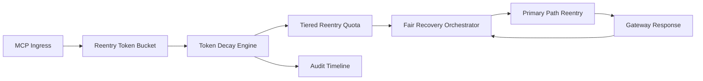

# APIM MCP 重入令牌衰减公平选型 FAQ（Cycle 1933）

## 1) 3 分钟结论
- **核心问题：** MCP 会话重入若缺少令牌衰减机制，高频租户会持续占用恢复通道并放大跨租户不公平。
- **推荐方案：** “重入令牌衰减 + 分层配额 + 公平恢复编排”三层治理。
- **目标：** 抑制重入抢占，稳定关键路径并提升恢复阶段租户公平性。

## 2) Q1 / Q2 / Q3
### Q1：为什么要做 reentry token decay fairness？
1) 固定令牌会让高频租户长期占优；
2) 无衰减机制时窗口边界仍会触发重复重入；
3) 无公平恢复编排时长尾租户恢复滞后。

### Q2：生产级如何设计？
- **衰减层：** 按窗口时间衰减重入令牌余额；
- **配额层：** 按 tenant+tier 分配重入速率与上限；
- **编排层：** 根据公平权重调度恢复顺序；
- **审计层：** 记录令牌消耗、衰减轨迹与恢复结果。

### Q3：上线判据是什么？
- 重入抖振率与超时率持续下降；
- 峰值窗口关键吞吐保持稳定；
- 令牌/配额/恢复动作可审计、可重放、可复算。

## 3) 架构图

## 4) 选型矩阵
| 维度 | 固定重入令牌 | Reentry Token Decay Fairness（推荐） |
|---|---:|---:|
| 关键路径稳定性 | 中 | 高 |
| 重入抢占抑制 | 低 | 高 |
| 租户恢复公平性 | 中 | 高 |
| 运维可解释性 | 中 | 高 |
| 实施复杂度 | 低 | 中 |

## 5) 数据证据与可复算算例（含 n 分母来源）
- 证据文件：
  - `workshops/azure-agent-infra/evidence/cycle-1933-benchmark.json`
  - `workshops/azure-agent-infra/evidence/cycle-1933-latency.csv`
  - `workshops/azure-agent-infra/evidence/cycle-1933-throughput.csv`
  - `workshops/azure-agent-infra/evidence/cycle-1933-cost.csv`
- 标签：`measured / synthetic / anonymized_reported`。
- 口径：固定采样窗口、固定令牌衰减策略、固定成本模型，可重复复算。

## 6) 生产检查清单
- [ ] 令牌衰减函数与窗口边界行为通过回放验证。
- [ ] 分层重入配额与租户边界一致。
- [ ] 公平恢复编排支持灰度开关与回滚。
- [ ] 令牌/重入/恢复轨迹可按租户审计。
- [ ] FAQ/H5/SVG/7-card/evidence 的 cycle/topic 一致。
