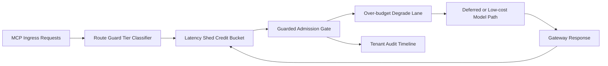

# APIM MCP Route Guard Latency Shed Fairness Selection FAQ (Cycle 1926)

## 1) Three-minute decision
- **Core issue:** under burst expansion, a globally shared latency budget can starve critical chains across tenants.
- **Recommendation:** combine route-guard tiering, latency-shed credit buckets, and over-budget degrade lanes.
- **Goal:** keep critical paths stable in burst windows while reducing cross-tenant latency drift.

## 2) Q1 / Q2 / Q3
### Q1: Why enforce route-guard latency-shed fairness?
1) global budget pooling amplifies high-frequency tenant contention,
2) without shed credit buckets, burst traffic depletes budget instantly,
3) without degrade lanes, over-budget requests timeout or fail.

### Q2: How should production design work?
- **Guard tier layer:** define route guards and budget lanes by tenant+tier+toolclass,
- **Credit shed layer:** configure per-lane bucket refill cadence and cooldown penalties,
- **Degrade fallback layer:** send over-budget requests to low-cost model lane or deferred queue,
- **Audit replay layer:** persist budget spend, fallback hits, and recovery traces per tenant.

### Q3: What is the go-live bar?
- route-mismatch and timeout rates continue to decline,
- critical throughput stays stable in burst windows,
- guard/shed/fallback actions are replayable and auditable.

## 3) Reference architecture

## 4) Decision matrix
| Dimension | Global shared latency budget | Route-Guard Latency Shed Fairness (Recommended) |
|---|---:|---:|
| Critical request protection | Low | High |
| Peak stability | Medium | High |
| Latency cost control | Medium | High |
| Operational explainability | Medium | High |
| Implementation complexity | Low | Medium |

## 5) Evidence and reproducibility
- Evidence files:
  - `workshops/azure-agent-infra/evidence/cycle-1926-benchmark.json`
  - `workshops/azure-agent-infra/evidence/cycle-1926-latency.csv`
  - `workshops/azure-agent-infra/evidence/cycle-1926-throughput.csv`
  - `workshops/azure-agent-infra/evidence/cycle-1926-cost.csv`
- Labels: `measured / synthetic / anonymized_reported`.
- Repro method: fixed sampling window, fixed route-guard policy, fixed cost model.

## 6) Production checklist
- [ ] Route-guard tiering aligns with tenant boundaries.
- [ ] Latency-shed credit parameters pass replay verification.
- [ ] Over-budget degrade strategy includes cooldown and rollback switches.
- [ ] Guard/fallback/recovery trails are tenant-auditable.
- [ ] FAQ/H5/SVG/7-card/evidence remain cycle-topic consistent.
