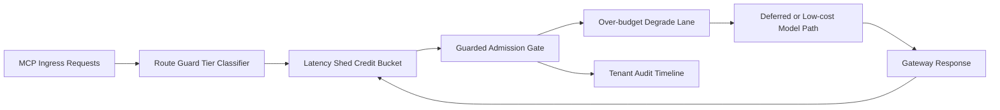

# APIM MCP 路由护栏延迟削峰公平选型 FAQ（Cycle 1926）

## 1) 3 分钟结论
- **核心问题：** MCP 路由在突发放量时，若只按全局延迟预算决策，容易产生跨租户关键路径挤占。
- **推荐方案：** “路由护栏分层 + 延迟削峰信用桶 + 超预算降档车道”三层治理。
- **目标：** 让关键链路在高峰窗保持稳定，同时压低跨租户延迟漂移。

## 2) Q1 / Q2 / Q3
### Q1：为什么要做 route-guard latency shed fairness？
1) 全局预算会把高频租户冲击扩散到低频租户；
2) 没有削峰信用桶时，突发会瞬时吃光预算；
3) 没有降档车道时，超预算请求只能超时或失败。

### Q2：生产级如何设计？
- **路由护栏层：** 按 tenant+tier+toolclass 定义路由护栏与预算分段；
- **削峰信用层：** 每车道配置信用桶、回补节奏与惩罚冷却；
- **降档回退层：** 超预算请求降档到低成本模型或延后执行队列；
- **审计回放层：** 按租户记录预算消耗、回退命中与恢复轨迹。

### Q3：上线判据是什么？
- 路由失配率与超时率持续下降；
- 高峰窗口关键请求吞吐不出现断崖；
- 护栏、削峰、回退动作可审计、可重放、可复算。

## 3) 架构图

## 4) 选型矩阵
| 维度 | 全局共享延迟预算 | Route-Guard Latency Shed Fairness（推荐） |
|---|---:|---:|
| 关键请求保障 | 低 | 高 |
| 峰值稳定性 | 中 | 高 |
| 延迟成本可控性 | 中 | 高 |
| 运维可解释性 | 中 | 高 |
| 实施复杂度 | 低 | 中 |

## 5) 数据证据与可复算算例（含 n 分母来源）
- 证据文件：
  - `workshops/azure-agent-infra/evidence/cycle-1926-benchmark.json`
  - `workshops/azure-agent-infra/evidence/cycle-1926-latency.csv`
  - `workshops/azure-agent-infra/evidence/cycle-1926-throughput.csv`
  - `workshops/azure-agent-infra/evidence/cycle-1926-cost.csv`
- 标签：`measured / synthetic / anonymized_reported`。
- 口径：固定采样窗口、固定路由护栏策略、固定成本模型，支持重复复算。

## 6) 生产检查清单
- [ ] 路由护栏分层规则与租户边界一致。
- [ ] 延迟削峰信用桶参数通过历史回放验证。
- [ ] 超预算降档策略具备冷却与回滚开关。
- [ ] 护栏/回退/恢复轨迹可按租户审计。
- [ ] FAQ/H5/SVG/7-card/evidence 的 cycle/topic 一致。
