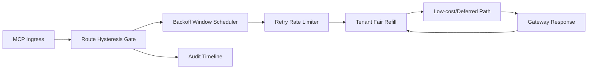

# APIM MCP Route Hysteresis Backoff Fairness Selection FAQ (Cycle 1929)

## 1) Three-minute decision
- **Core issue:** without hysteresis backoff in peak fallback windows, MCP routing can flap and amplify cross-tenant latency jitter.
- **Recommendation:** combine route hysteresis dual thresholds, backoff windows, and tenant-fair refill.
- **Goal:** reduce route flapping and false fallback triggers while preserving critical throughput and fair recovery.

## 2) Q1 / Q2 / Q3
### Q1: Why enforce route hysteresis backoff fairness?
1) single-threshold switching flaps under boundary loads,
2) without backoff windows, fallback/restore oscillates in short cycles,
3) without fair refill, low-frequency tenants recover slower.

### Q2: How should production design work?
- **Hysteresis layer:** set dual thresholds and minimum dwell time,
- **Backoff layer:** enforce lane-scoped backoff and retry-rate limits,
- **Refill layer:** execute tenant-priority fair refill windows,
- **Audit layer:** persist threshold hits, switch traces, and recovery closure.

### Q3: What is the go-live bar?
- route switch and timeout rates keep dropping,
- critical throughput remains stable at peak,
- hysteresis/backoff/refill actions are replayable, auditable, reproducible.

## 3) Reference architecture

## 4) Decision matrix
| Dimension | Non-hysteresis-backoff routing | Route Hysteresis Backoff Fairness (Recommended) |
|---|---:|---:|
| Critical-path stability | Low | High |
| Switch jitter control | Low | High |
| Tenant recovery fairness | Medium | High |
| Operational explainability | Medium | High |
| Implementation complexity | Low | Medium |

## 5) Evidence and reproducibility
- Evidence files:
  - `workshops/azure-agent-infra/evidence/cycle-1929-benchmark.json`
  - `workshops/azure-agent-infra/evidence/cycle-1929-latency.csv`
  - `workshops/azure-agent-infra/evidence/cycle-1929-throughput.csv`
  - `workshops/azure-agent-infra/evidence/cycle-1929-cost.csv`
- Labels: `measured / synthetic / anonymized_reported`.
- Repro method: fixed sampling windows, fixed hysteresis-backoff policy, fixed cost model.

## 6) Production checklist
- [ ] Hysteresis thresholds and dwell times pass replay verification.
- [ ] Backoff windows and retry limits align with tenant boundaries.
- [ ] Fair-refill windows support staged rollout and rollback.
- [ ] Route/fallback/recovery trails are tenant-auditable.
- [ ] FAQ/H5/SVG/7-card/evidence remain cycle-topic consistent.
