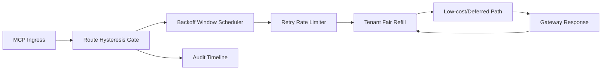

# APIM MCP 路由滞回退避公平选型 FAQ（Cycle 1929）

## 1) 3 分钟结论
- **核心问题：** MCP 路由在高峰回退期若缺少滞回退避，会出现频繁切换并放大跨租户延迟抖动。
- **推荐方案：** “路由滞回双阈值 + 退避窗口 + 租户公平回补”三层治理。
- **目标：** 降低路由抖振与误回退，稳定关键链路并保持公平恢复。

## 2) Q1 / Q2 / Q3
### Q1：为什么要做 route hysteresis backoff fairness？
1) 单阈值切换在边界负载下容易抖振；
2) 无退避窗口时回退/恢复会短周期来回震荡；
3) 无公平回补时低频租户恢复速度落后。

### Q2：生产级如何设计？
- **滞回层：** 设置升降档双阈值与最小驻留时长；
- **退避层：** 回退触发后按租户车道退避并限制重试速率；
- **回补层：** 依据租户优先级执行公平回补窗口；
- **审计层：** 全量记录阈值命中、切换轨迹与恢复闭环。

### Q3：上线判据是什么？
- 路由切换频率和超时率持续下降；
- 关键请求吞吐在峰值窗口保持平稳；
- 滞回/退避/回补动作可重放、可审计、可复算。

## 3) 架构图

## 4) 选型矩阵
| 维度 | 无滞回退避路由 | Route Hysteresis Backoff Fairness（推荐） |
|---|---:|---:|
| 关键路径稳定性 | 低 | 高 |
| 切换抖振可控性 | 低 | 高 |
| 租户恢复公平性 | 中 | 高 |
| 运维可解释性 | 中 | 高 |
| 实施复杂度 | 低 | 中 |

## 5) 数据证据与可复算算例（含 n 分母来源）
- 证据文件：
  - `workshops/azure-agent-infra/evidence/cycle-1929-benchmark.json`
  - `workshops/azure-agent-infra/evidence/cycle-1929-latency.csv`
  - `workshops/azure-agent-infra/evidence/cycle-1929-throughput.csv`
  - `workshops/azure-agent-infra/evidence/cycle-1929-cost.csv`
- 标签：`measured / synthetic / anonymized_reported`。
- 口径：固定采样窗口、固定滞回退避策略、固定成本模型，可重复复算。

## 6) 生产检查清单
- [ ] 路由滞回阈值与驻留时长配置通过回放验证。
- [ ] 退避窗口和重试速率限制与租户边界一致。
- [ ] 公平回补窗口支持灰度开关与回滚。
- [ ] 路由切换/回退/恢复轨迹可按租户审计。
- [ ] FAQ/H5/SVG/7-card/evidence 的 cycle/topic 一致。
