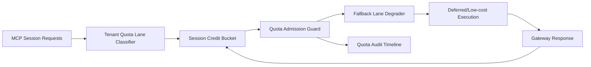

# APIM MCP Session Quota Fairness Lane Selection FAQ (Cycle 1918)

## 1) Three-minute decision
- **Core issue:** under MCP tool-call bursts, global first-come quota allocation causes sustained queueing and timeout spikes for lower-priority tenants.
- **Recommendation:** combine tenant quota lanes, session credit buckets, and overflow fallback lanes.
- **Goal:** protect key-tenant SLOs while increasing aggregate throughput and reducing queue jitter.

## 2) Q1 / Q2 / Q3
### Q1: Why enforce session quota fairness lanes?
1) global quota contention amplifies noisy-tenant dominance,
2) without credit buckets, short bursts trigger cascading queues,
3) without fallback lanes, over-quota requests fail by timeout only.

### Q2: How should production design work?
- **Lane layer:** classify quota lanes by tenant+tier+toolclass,
- **Credit layer:** configure per-lane session credit bucket and cooldown,
- **Fallback layer:** route over-quota calls to degraded model or deferred lane,
- **Audit layer:** persist deny/degrade/recover events by tenant.

### Q3: What is the go-live bar?
- lower unfair-quota rate and timeout rate,
- stable overall throughput after fallback-lane activation,
- replayable and auditable quota decisions with deterministic recompute.

## 3) Reference architecture

## 4) Decision matrix
| Dimension | Global first-come quota | Session Quota Fairness Lane (Recommended) |
|---|---:|---:|
| Multi-tenant fairness | Low | High |
| Peak throughput stability | Medium | High |
| Timeout suppression | Medium | High |
| Operational explainability | Medium | High |
| Implementation complexity | Low | Medium |

## 5) Evidence and reproducibility
- Evidence files:
  - `workshops/azure-agent-infra/evidence/cycle-1918-benchmark.json`
  - `workshops/azure-agent-infra/evidence/cycle-1918-latency.csv`
  - `workshops/azure-agent-infra/evidence/cycle-1918-throughput.csv`
  - `workshops/azure-agent-infra/evidence/cycle-1918-cost.csv`
- Labels: `measured / synthetic / anonymized_reported`.
- Repro method: fixed sampling window, fixed quota/fallback policy, fixed cost model.

## 6) Production checklist
- [ ] Quota lane policy aligns with tenant isolation boundaries.
- [ ] Session credit buckets pass historical replay verification.
- [ ] Fallback lanes include cooldown and rollback switches.
- [ ] Deny/degrade/recover trails are tenant-auditable.
- [ ] FAQ/H5/SVG/7-card/evidence remain cycle-topic consistent.
