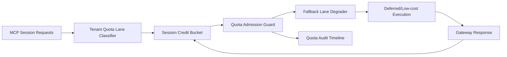

# APIM MCP Session Quota Fairness Lane 选型 FAQ（Cycle 1918）

## 1) 3 分钟结论
- **核心问题：** MCP 工具调用高峰下，若会话配额按全局先到先得分配，低优先级租户会出现持续排队与突发超时。
- **推荐方案：** “租户配额分道 + 会话信用桶 + 超额回退车道”三层治理。
- **目标：** 在保障关键租户 SLO 的同时，提高总体吞吐并降低排队抖动。

## 2) Q1 / Q2 / Q3
### Q1：为什么要做 session quota fairness lane？
1) 全局配额竞争会放大高频租户的资源挤占；
2) 无信用桶时，短时突发会触发级联排队；
3) 无回退车道时，超额请求只能超时失败，恢复慢。

### Q2：生产级如何设计？
- **分道层：** 按 tenant+tier+toolclass 划分配额车道；
- **信用层：** 每车道配置会话信用桶与冷却周期；
- **回退层：** 超额请求进入降级模型或延迟执行车道；
- **审计层：** 记录拒绝、降级、恢复三类事件并按租户追踪。

### Q3：上线判据是什么？
- 会话配额不公平率与超时率持续下降；
- 回退车道命中后整体吞吐保持稳定；
- 配额决策可回放、可审计、可复算。

## 3) 架构图

## 4) 选型矩阵
| 维度 | 全局先到先得配额 | Session Quota Fairness Lane（推荐） |
|---|---:|---:|
| 多租户公平性 | 低 | 高 |
| 峰值吞吐稳定性 | 中 | 高 |
| 超时抑制能力 | 中 | 高 |
| 运维可解释性 | 中 | 高 |
| 实施复杂度 | 低 | 中 |

## 5) 证据与复算口径
- 证据文件：
  - `workshops/azure-agent-infra/evidence/cycle-1918-benchmark.json`
  - `workshops/azure-agent-infra/evidence/cycle-1918-latency.csv`
  - `workshops/azure-agent-infra/evidence/cycle-1918-throughput.csv`
  - `workshops/azure-agent-infra/evidence/cycle-1918-cost.csv`
- 标签：`measured / synthetic / anonymized_reported`。
- 口径：固定采样窗口、固定配额与回退策略、固定成本模型，支持重复复算。

## 6) 生产检查清单
- [ ] 配额分道规则与租户隔离边界一致。
- [ ] 会话信用桶参数通过历史回放验证。
- [ ] 回退车道具备冷却与回滚开关。
- [ ] 拒绝/降级/恢复轨迹可按租户审计。
- [ ] FAQ/H5/SVG/7-card/evidence 的 cycle/topic 一致。
