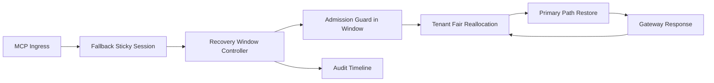

# APIM MCP Sticky Recovery Window Fairness Selection FAQ (Cycle 1931)

## 1) Three-minute decision
- **Core issue:** without sticky recovery windows after fallback, traffic flaps between primary and fallback paths and amplifies cross-tenant unfairness.
- **Recommendation:** combine sticky recovery windows, admission guards, and tenant-fair reallocation.
- **Goal:** reduce recovery oscillation and false migration while preserving critical throughput and recovery consistency.

## 2) Q1 / Q2 / Q3
### Q1: Why enforce sticky recovery window fairness?
1) without recovery windows, fallback sessions re-enter primary too early and flap,
2) without admission guards, high-frequency tenants dominate recovery bandwidth,
3) without fair reallocation, low-frequency tenants recover slower.

### Q2: How should production design work?
- **Window layer:** set minimum sticky recovery windows for fallback sessions,
- **Guard layer:** cap migration-back rates with in-window admission guards,
- **Reallocation layer:** allocate recovery bandwidth by tenant weight,
- **Audit layer:** persist window hits, migration traces, and recovery outcomes.

### Q3: What is the go-live bar?
- recovery oscillation and timeout rates continue to decline,
- critical throughput stays stable in peak windows,
- window/guard/reallocation actions are auditable, replayable, reproducible.

## 3) Reference architecture

## 4) Decision matrix
| Dimension | No sticky recovery window | Sticky Recovery Window Fairness (Recommended) |
|---|---:|---:|
| Critical-path stability | Low | High |
| Recovery oscillation suppression | Low | High |
| Tenant recovery fairness | Medium | High |
| Operational explainability | Medium | High |
| Implementation complexity | Low | Medium |

## 5) Evidence and reproducibility
- Evidence files:
  - `workshops/azure-agent-infra/evidence/cycle-1931-benchmark.json`
  - `workshops/azure-agent-infra/evidence/cycle-1931-latency.csv`
  - `workshops/azure-agent-infra/evidence/cycle-1931-throughput.csv`
  - `workshops/azure-agent-infra/evidence/cycle-1931-cost.csv`
- Labels: `measured / synthetic / anonymized_reported`.
- Repro method: fixed sampling windows, fixed sticky-recovery policy, fixed cost model.

## 6) Production checklist
- [ ] Sticky recovery window duration and exits pass replay verification.
- [ ] In-window admission guards align with tenant boundaries.
- [ ] Recovery bandwidth reallocation supports staged rollout and rollback.
- [ ] Migration/recovery trails are tenant-auditable.
- [ ] FAQ/H5/SVG/7-card/evidence remain cycle-topic consistent.
