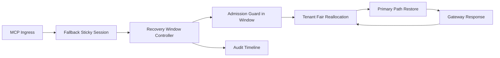

# APIM MCP 粘性恢复窗口公平选型 FAQ（Cycle 1931）

## 1) 3 分钟结论
- **核心问题：** MCP 回退后若缺少粘性恢复窗口，流量会在主路径与回退路径间频繁摆动并放大跨租户不公平。
- **推荐方案：** “粘性恢复窗口 + 准入护栏 + 租户公平再分配”三层治理。
- **目标：** 降低恢复抖振与误迁移，稳定关键吞吐并提升租户恢复一致性。

## 2) Q1 / Q2 / Q3
### Q1：为什么要做 sticky recovery window fairness？
1) 无恢复窗口会导致回退后立即抢回主路径，引发抖振；
2) 无准入护栏时高频租户会挤占恢复带宽；
3) 无公平再分配时低频租户恢复速度持续落后。

### Q2：生产级如何设计？
- **窗口层：** 为回退会话设置最小粘性恢复窗口；
- **护栏层：** 在窗口内使用准入护栏限制迁回速率；
- **再分配层：** 以租户权重执行恢复带宽公平分配；
- **审计层：** 记录窗口命中、迁回轨迹与恢复结果。

### Q3：上线判据是什么？
- 恢复抖振率与超时率持续下降；
- 峰值窗口关键路径吞吐保持平稳；
- 窗口/护栏/再分配动作可审计、可重放、可复算。

## 3) 架构图

## 4) 选型矩阵
| 维度 | 无粘性恢复窗口 | Sticky Recovery Window Fairness（推荐） |
|---|---:|---:|
| 关键路径稳定性 | 低 | 高 |
| 恢复抖振抑制 | 低 | 高 |
| 租户恢复公平性 | 中 | 高 |
| 运维可解释性 | 中 | 高 |
| 实施复杂度 | 低 | 中 |

## 5) 数据证据与可复算算例（含 n 分母来源）
- 证据文件：
  - `workshops/azure-agent-infra/evidence/cycle-1931-benchmark.json`
  - `workshops/azure-agent-infra/evidence/cycle-1931-latency.csv`
  - `workshops/azure-agent-infra/evidence/cycle-1931-throughput.csv`
  - `workshops/azure-agent-infra/evidence/cycle-1931-cost.csv`
- 标签：`measured / synthetic / anonymized_reported`。
- 口径：固定采样窗口、固定粘性恢复窗口策略、固定成本模型，可重复复算。

## 6) 生产检查清单
- [ ] 粘性恢复窗口时长与退出条件通过回放验证。
- [ ] 窗口内准入护栏与租户边界一致。
- [ ] 恢复带宽再分配支持灰度开关与回滚。
- [ ] 迁回/恢复轨迹可按租户审计。
- [ ] FAQ/H5/SVG/7-card/evidence 的 cycle/topic 一致。
