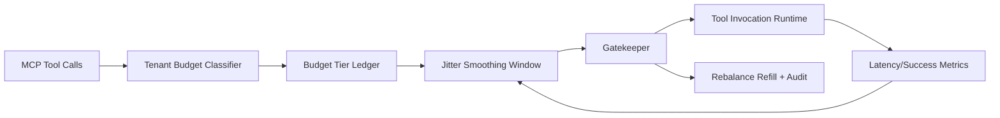

# APIM MCP Tool Call Budget Jitter Selection FAQ (Cycle 1914)

## 1) Three-minute decision
- **Core issue:** under multi-tenant bursts, missing budget and jitter controls causes cascading retries and queue oscillation for MCP tool calls.
- **Recommendation:** combine tenant-tier budgets, jitter-smoothing windows, and guarded rebalance refill.
- **Goal:** constrain budget-jitter spread while stabilizing tool-call success and tail latency.

## 2) Q1 / Q2 / Q3
### Q1: Why govern tool-call budget jitter?
1) flat budgets let noisy tenants consume invocation quota,
2) jitter spikes amplify retry chains,
3) missing refill gates reintroduce imbalance during recovery.

### Q2: How should production design work?
- **Budget layer:** set invocation budgets by tenant tier and tool class,
- **Smoothing layer:** apply windowed jitter smoothing and burst clipping,
- **Refill layer:** rebalance quota by critical priority after imbalance,
- **Audit layer:** persist budget debits, denials, and refill trail.

### Q3: What is the go-live bar?
- stable tool-call success under peak windows,
- reduced jitter amplitude and quota-conflict rate,
- replayable and explainable gate/refill actions.

## 3) Reference architecture

## 4) Decision matrix
| Dimension | No budget-jitter governance | Tool Call Budget Jitter Governance (Recommended) |
|---|---:|---:|
| Peak success stability | Low | High |
| Cross-tenant fairness | Low | High |
| Retry-chain control | Medium | High |
| Operational explainability | Medium | High |
| Implementation complexity | Low | Medium |

## 5) Evidence and reproducibility
- Evidence files:
  - `workshops/azure-agent-infra/evidence/cycle-1914-benchmark.json`
  - `workshops/azure-agent-infra/evidence/cycle-1914-latency.csv`
  - `workshops/azure-agent-infra/evidence/cycle-1914-throughput.csv`
  - `workshops/azure-agent-infra/evidence/cycle-1914-cost.csv`
- Labels: `measured / synthetic / anonymized_reported`.
- Repro method: fixed sampling windows, fixed budget rules, fixed cost model.

## 6) Production checklist
- [ ] Tenant budget tiers align with SLA classes.
- [ ] Jitter-smoothing parameters pass peak replay.
- [ ] Rebalance/refill includes cooldown and rollback switches.
- [ ] Budget denial/refill trails are tenant-auditable.
- [ ] FAQ/H5/SVG/7-card/evidence remain cycle-topic consistent.
