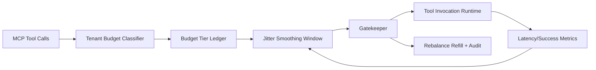

# APIM MCP Tool Call Budget Jitter 选型 FAQ（Cycle 1914）

## 1) 3 分钟结论
- **核心问题：** MCP 工具调用在多租户突发下，若预算与抖动控制缺失，会产生级联重试与队列震荡。
- **推荐方案：** “租户预算分层 + 抖动平滑窗口 + 失衡回补门禁”三层治理。
- **目标：** 约束调用预算抖动扩散，稳定工具调用成功率与网关尾延迟。

## 2) Q1 / Q2 / Q3
### Q1：为什么要治理 tool call budget jitter？
1) 预算不分层会让高频租户抢占调用额度；
2) 抖动峰值放大会触发重试链式反应；
3) 缺少回补门禁会导致预算恢复期再次失衡。

### Q2：生产级如何设计？
- **预算层：** 按租户等级与工具类别定义调用预算上限；
- **平滑层：** 引入时间窗口抖动平滑与突发削峰；
- **回补层：** 失衡后按关键业务优先级回补额度；
- **审计层：** 记录预算扣减、拒绝原因与回补轨迹。

### Q3：上线判据是什么？
- 工具调用成功率在峰值窗口保持稳定；
- 预算抖动幅度与冲突率显著下降；
- 门禁与回补动作可回放、可解释、可复算。

## 3) 架构图

## 4) 选型矩阵
| 维度 | 无预算抖动治理 | Tool Call Budget Jitter Governance（推荐） |
|---|---:|---:|
| 峰值成功率稳定性 | 低 | 高 |
| 跨租户公平性 | 低 | 高 |
| 重试链路可控性 | 中 | 高 |
| 运维可解释性 | 中 | 高 |
| 实施复杂度 | 低 | 中 |

## 5) 证据与复算口径
- 证据文件：
  - `workshops/azure-agent-infra/evidence/cycle-1914-benchmark.json`
  - `workshops/azure-agent-infra/evidence/cycle-1914-latency.csv`
  - `workshops/azure-agent-infra/evidence/cycle-1914-throughput.csv`
  - `workshops/azure-agent-infra/evidence/cycle-1914-cost.csv`
- 标签：`measured / synthetic / anonymized_reported`。
- 口径：固定采样窗口、固定预算规则、固定成本模型，支持重复复算。

## 6) 生产检查清单
- [ ] 租户预算分层与 SLA 等级一致。
- [ ] jitter smoothing 参数通过峰值回放验证。
- [ ] rebalance/refill 具备冷却与回滚开关。
- [ ] 预算拒绝与回补轨迹可按租户审计。
- [ ] FAQ/H5/SVG/7-card/evidence 的 cycle/topic 一致。
