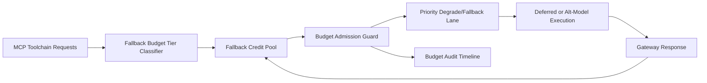

# APIM MCP Toolchain Fallback Budget Fairness Selection FAQ (Cycle 1921)

## 1) Three-minute decision
- **Core issue:** when MCP toolchains share one global fallback budget, non-critical paths can starve critical paths and trigger cascading timeout failures.
- **Recommendation:** combine toolchain-tiered budgeting, fallback credit pools, and priority degrade/fallback lanes.
- **Goal:** keep critical throughput and recovery stable while controlling fallback spend.

## 2) Q1 / Q2 / Q3
### Q1: Why enforce fallback budget fairness?
1) global budget pools amplify noisy path contention against critical chains,
2) without credit pools, short bursts deplete fallback budget quickly,
3) without priority degrade policy, critical and non-critical requests fail equally.

### Q2: How should production design work?
- **Tier layer:** partition fallback budget by tenant+tier+toolchain,
- **Credit layer:** assign per-tier fallback credit pool with refill cadence,
- **Priority layer:** over-budget requests degrade by criticality to alt-model/deferred queue,
- **Audit layer:** persist budget spend, degrade hits, and recovery traces.

### Q3: What is the go-live bar?
- lower budget-unfairness and timeout rates,
- critical chains sustain target throughput at peak,
- budget/degrade actions are replayable, auditable, and recomputable.

## 3) Reference architecture

## 4) Decision matrix
| Dimension | Global shared fallback budget | Fallback Budget Fairness (Recommended) |
|---|---:|---:|
| Critical path protection | Low | High |
| Peak stability | Medium | High |
| Fallback cost control | Medium | High |
| Operational explainability | Medium | High |
| Implementation complexity | Low | Medium |

## 5) Evidence and reproducibility
- Evidence files:
  - `workshops/azure-agent-infra/evidence/cycle-1921-benchmark.json`
  - `workshops/azure-agent-infra/evidence/cycle-1921-latency.csv`
  - `workshops/azure-agent-infra/evidence/cycle-1921-throughput.csv`
  - `workshops/azure-agent-infra/evidence/cycle-1921-cost.csv`
- Labels: `measured / synthetic / anonymized_reported`.
- Repro method: fixed sampling window, fixed fallback-budget policy, fixed cost model.

## 6) Production checklist
- [ ] Budget tiering aligns with tenant boundaries.
- [ ] Fallback-credit parameters pass historical replay verification.
- [ ] Priority degrade policy includes cooldown and rollback switches.
- [ ] Budget/degrade/recover trails are tenant-auditable.
- [ ] FAQ/H5/SVG/7-card/evidence remain cycle-topic consistent.
