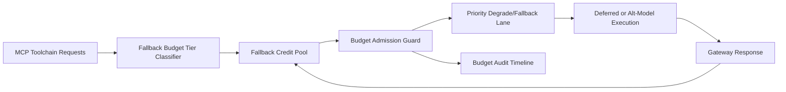

# APIM MCP Toolchain Fallback Budget Fairness 选型 FAQ（Cycle 1921）

## 1) 3 分钟结论
- **核心问题：** MCP 工具链在高峰期若回退预算按全局共享，关键任务会被非关键链路挤占并触发级联超时。
- **推荐方案：** “工具链分层预算 + fallback credit 池 + 降级回退优先级”三层治理。
- **目标：** 在控制回退成本的同时保持关键路径吞吐与恢复稳定。

## 2) Q1 / Q2 / Q3
### Q1：为什么要做 fallback budget fairness？
1) 全局预算池会放大高频链路对关键链路的挤占；
2) 无 credit 池时，短时突发会耗尽回退预算；
3) 无优先级降级策略时，关键请求与非关键请求同等失败。

### Q2：生产级如何设计？
- **分层层：** 按 tenant+tier+toolchain 划分回退预算；
- **信用层：** 每预算层配置 fallback credit 池与回补周期；
- **优先级层：** 超额时按关键级别降级至替代模型/延迟队列；
- **审计层：** 记录预算消耗、降级命中与恢复轨迹。

### Q3：上线判据是什么？
- 回退预算不公平率与超时率持续下降；
- 关键链路在高峰期仍保持目标吞吐；
- 预算与降级动作可审计、可重放、可复算。

## 3) 架构图

## 4) 选型矩阵
| 维度 | 全局共享回退预算 | Fallback Budget Fairness（推荐） |
|---|---:|---:|
| 关键路径保障 | 低 | 高 |
| 峰值稳定性 | 中 | 高 |
| 回退成本可控性 | 中 | 高 |
| 运维可解释性 | 中 | 高 |
| 实施复杂度 | 低 | 中 |

## 5) 证据与复算口径
- 证据文件：
  - `workshops/azure-agent-infra/evidence/cycle-1921-benchmark.json`
  - `workshops/azure-agent-infra/evidence/cycle-1921-latency.csv`
  - `workshops/azure-agent-infra/evidence/cycle-1921-throughput.csv`
  - `workshops/azure-agent-infra/evidence/cycle-1921-cost.csv`
- 标签：`measured / synthetic / anonymized_reported`。
- 口径：固定采样窗口、固定 fallback 预算策略、固定成本模型，支持重复复算。

## 6) 生产检查清单
- [ ] 回退预算分层规则与租户边界一致。
- [ ] fallback credit 参数通过历史回放验证。
- [ ] 优先级降级策略具备冷却与回滚开关。
- [ ] 预算/降级/恢复轨迹可按租户审计。
- [ ] FAQ/H5/SVG/7-card/evidence 的 cycle/topic 一致。
