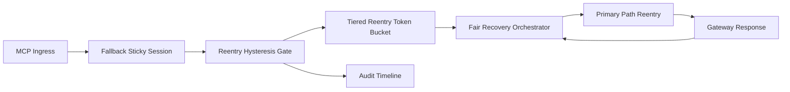

# APIM MCP Window Reentry Hysteresis Fairness Selection FAQ (Cycle 1932)

## 1) Three-minute decision
- **Core issue:** if fallback sessions reenter primary immediately after window close, route flapping repeats and squeezes other tenants' recovery quotas.
- **Recommendation:** combine reentry hysteresis, tiered reentry quotas, and fair recovery orchestration.
- **Goal:** reduce reentry oscillation and false recoveries while preserving critical-path stability and cross-tenant fairness.

## 2) Q1 / Q2 / Q3
### Q1: Why enforce window reentry hysteresis fairness?
1) without reentry hysteresis, sessions flap around window boundaries,
2) without tiered reentry quotas, high-frequency tenants dominate recovery channels,
3) without fair recovery orchestration, long-tail tenants lag.

### Q2: How should production design work?
- **Hysteresis layer:** apply dual thresholds and minimum dwell time for reentry,
- **Quota layer:** assign tenant/tier reentry tokens and rate limits,
- **Orchestration layer:** schedule recovery order by fairness weights,
- **Audit layer:** persist reentry triggers, fallback returns, and recovery closure.

### Q3: What is the go-live bar?
- reentry oscillation and timeout rates keep dropping,
- critical throughput stays stable at peak,
- reentry/quota/recovery actions are auditable, replayable, reproducible.

## 3) Reference architecture

## 4) Decision matrix
| Dimension | No reentry hysteresis control | Window Reentry Hysteresis Fairness (Recommended) |
|---|---:|---:|
| Critical-path stability | Low | High |
| Reentry oscillation suppression | Low | High |
| Tenant recovery fairness | Medium | High |
| Operational explainability | Medium | High |
| Implementation complexity | Low | Medium |

## 5) Evidence and reproducibility
- Evidence files:
  - `workshops/azure-agent-infra/evidence/cycle-1932-benchmark.json`
  - `workshops/azure-agent-infra/evidence/cycle-1932-latency.csv`
  - `workshops/azure-agent-infra/evidence/cycle-1932-throughput.csv`
  - `workshops/azure-agent-infra/evidence/cycle-1932-cost.csv`
- Labels: `measured / synthetic / anonymized_reported`.
- Repro method: fixed sampling windows, fixed reentry-hysteresis policy, fixed cost model.

## 6) Production checklist
- [ ] Reentry hysteresis thresholds and dwell windows pass replay verification.
- [ ] Tiered reentry quotas align with tenant boundaries.
- [ ] Fair recovery orchestration supports staged rollout and rollback.
- [ ] Reentry/fallback/recovery trails are tenant-auditable.
- [ ] FAQ/H5/SVG/7-card/evidence remain cycle-topic consistent.
