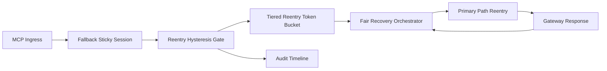

# APIM MCP 窗口重入滞回公平选型 FAQ（Cycle 1932）

## 1) 3 分钟结论
- **核心问题：** MCP 回退会话在窗口结束后若立即重入主路径，容易触发重复抖振并挤压其他租户恢复配额。
- **推荐方案：** “窗口重入滞回 + 分层重入配额 + 公平恢复编排”三层治理。
- **目标：** 降低重入抖振与误恢复，稳定关键链路并保持跨租户公平。

## 2) Q1 / Q2 / Q3
### Q1：为什么要做 window reentry hysteresis fairness？
1) 无重入滞回时窗口边界会反复进出主路径；
2) 无分层重入配额时高频租户会抢占恢复通道；
3) 无公平恢复编排时长尾租户恢复明显滞后。

### Q2：生产级如何设计？
- **滞回层：** 为重入设置双阈值与最小驻留时间；
- **配额层：** 对租户/层级设置重入令牌与速率上限；
- **编排层：** 按公平权重安排恢复顺序与节奏；
- **审计层：** 记录重入触发、回退回流、恢复完成轨迹。

### Q3：上线判据是什么？
- 重入抖振率与超时率持续下降；
- 峰值窗口关键吞吐保持稳定；
- 重入/配额/恢复动作可审计、可重放、可复算。

## 3) 架构图

## 4) 选型矩阵
| 维度 | 无重入滞回控制 | Window Reentry Hysteresis Fairness（推荐） |
|---|---:|---:|
| 关键路径稳定性 | 低 | 高 |
| 重入抖振抑制 | 低 | 高 |
| 租户恢复公平性 | 中 | 高 |
| 运维可解释性 | 中 | 高 |
| 实施复杂度 | 低 | 中 |

## 5) 数据证据与可复算算例（含 n 分母来源）
- 证据文件：
  - `workshops/azure-agent-infra/evidence/cycle-1932-benchmark.json`
  - `workshops/azure-agent-infra/evidence/cycle-1932-latency.csv`
  - `workshops/azure-agent-infra/evidence/cycle-1932-throughput.csv`
  - `workshops/azure-agent-infra/evidence/cycle-1932-cost.csv`
- 标签：`measured / synthetic / anonymized_reported`。
- 口径：固定采样窗口、固定重入滞回策略、固定成本模型，可重复复算。

## 6) 生产检查清单
- [ ] 重入滞回阈值与驻留时间通过回放验证。
- [ ] 分层重入配额与租户边界一致。
- [ ] 公平恢复编排支持灰度开关与回滚。
- [ ] 重入/回退/恢复轨迹可按租户审计。
- [ ] FAQ/H5/SVG/7-card/evidence 的 cycle/topic 一致。
