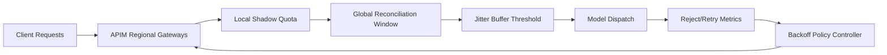

# APIM Multi-Region Quota Jitter Selection FAQ (Cycle 1903)

## 1) Three-minute decision
- **Core issue:** quota-state replication delays across APIM regions can cause jitter and rejection spikes during traffic shifts.
- **Recommendation:** combine local shadow quotas, global reconciliation windows, and jitter-buffer thresholds.
- **Goal:** smooth rejection behavior during cross-region routing and preserve critical throughput.

## 2) Q1 / Q2 / Q3
### Q1: Why is quota jitter worse in multi-region setups?
1) state replication naturally has latency,
2) rerouting amplifies transient quota divergence,
3) retries can stack additional burst pressure.

### Q2: How should production multi-region quota jitter be controlled?
- **Shadow quotas:** maintain short-cycle regional quota mirrors,
- **Reconciliation window:** periodically settle and compensate global deltas,
- **Jitter buffer:** apply smoothing thresholds during routing transitions,
- **Retry suppression:** enforce backoff policies for jitter-window failures.

### Q3: What is the go-live bar?
- lower rejection spikes during traffic shifts,
- fast convergence of cross-region quota deltas,
- no sustained retry-amplification peaks.

## 3) Reference architecture

## 4) Decision matrix
| Dimension | Single global-sync quota | Multi-Region Jitter Control (Recommended) |
|---|---:|---:|
| Shift-window stability | Low | High |
| Rejection smoothing | Low | High |
| Cross-region consistency | Medium | High |
| Implementation complexity | Low | Medium |
| Operational observability | Medium | High |

## 5) Evidence and reproducibility
- Evidence files:
  - `workshops/azure-agent-infra/evidence/cycle-1903-benchmark.json`
  - `workshops/azure-agent-infra/evidence/cycle-1903-latency.csv`
  - `workshops/azure-agent-infra/evidence/cycle-1903-throughput.csv`
  - `workshops/azure-agent-infra/evidence/cycle-1903-policy.csv`
- Labels: `measured / synthetic / anonymized_reported`.
- Validation chain: six-part FAQ, CSP, cycle/topic binding, simulator checks.

## 6) Production checklist
- [ ] Regional shadow quotas map cleanly to global quotas.
- [ ] Reconciliation compensation policies pass failure drills.
- [ ] Jitter-buffer thresholds are tuned with routing policies.
- [ ] Retry backoff auto-applies within jitter windows.
- [ ] FAQ/H5/SVG/7-card/evidence remain cycle-consistent.
