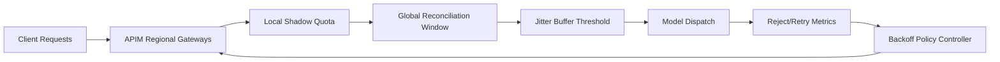

# APIM Multi-Region Quota Jitter 选型 FAQ（Cycle 1903）

## 1) 3 分钟结论
- **核心问题：** 多区域 APIM 配额同步存在时延差，容易在流量切换时触发 quota 抖动与瞬时拒绝峰。
- **推荐方案：** “区域本地配额影子 + 全局配额对账窗口 + 抖动缓冲阈值”三层机制。
- **目标：** 降低跨区域切流时的拒绝抖动，保持关键路径稳定吞吐。

## 2) Q1 / Q2 / Q3
### Q1：配额抖动为什么在多区域更突出？
1) 区域间状态复制有自然延迟；
2) 流量切换会放大瞬时配额不一致；
3) 重试策略可能叠加瞬时压力。

### Q2：生产级 multi-region quota jitter 如何治理？
- **影子配额：** 各区域维护短周期本地配额镜像；
- **对账窗口：** 全局控制平面周期性回收与补偿差额；
- **抖动缓冲：** 在切流窗口设置拒绝平滑阈值；
- **重试抑制：** 对抖动窗口内失败请求启用退避策略。

### Q3：上线判据是什么？
- 切流窗口拒绝率峰值显著下降；
- 区域间配额偏差在窗口内快速收敛；
- 重试放大率不再出现连续尖峰。

## 3) 架构图

## 4) 选型矩阵
| 维度 | 单一全局配额同步 | Multi-Region Jitter Control（推荐） |
|---|---:|---:|
| 切流稳定性 | 低 | 高 |
| 拒绝率平滑 | 低 | 高 |
| 跨区一致性 | 中 | 高 |
| 实施复杂度 | 低 | 中 |
| 运维可观测性 | 中 | 高 |

## 5) 证据与复算口径
- 证据文件：
  - `workshops/azure-agent-infra/evidence/cycle-1903-benchmark.json`
  - `workshops/azure-agent-infra/evidence/cycle-1903-latency.csv`
  - `workshops/azure-agent-infra/evidence/cycle-1903-throughput.csv`
  - `workshops/azure-agent-infra/evidence/cycle-1903-policy.csv`
- 标签：`measured / synthetic / anonymized_reported`。
- 校验链：FAQ 六段、CSP、cycle/topic 绑定、模拟器检查。

## 6) 生产检查清单
- [ ] 区域影子配额与全局配额映射已定义。
- [ ] 对账窗口补偿策略通过故障演练。
- [ ] 抖动缓冲阈值与切流策略联调完成。
- [ ] 重试退避在抖动窗口可自动生效。
- [ ] FAQ/H5/SVG/7-card/evidence 轮次一致。
