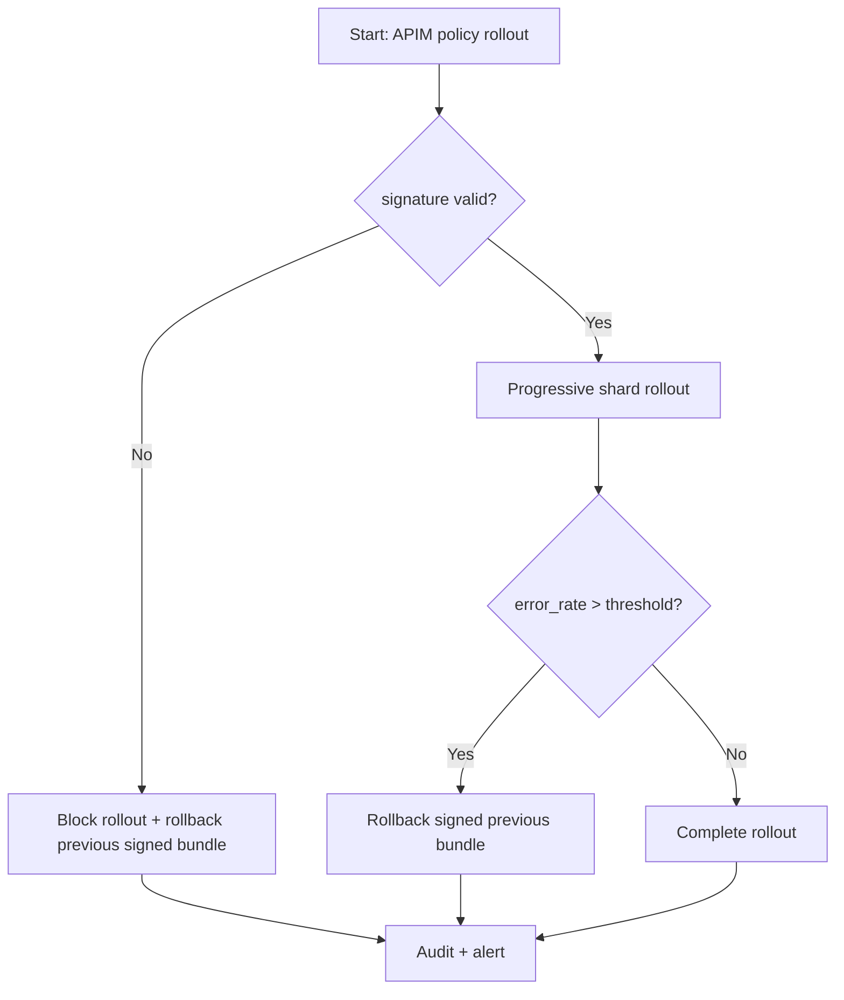
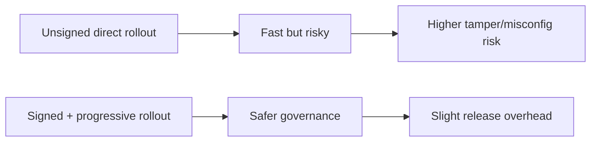
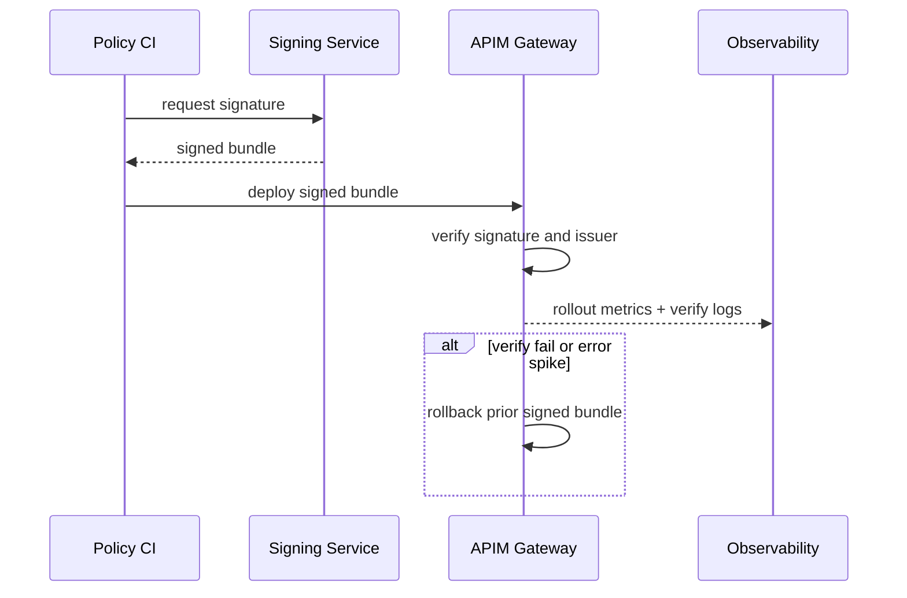

# Agent APIM Policy Bundle Signature Rollout Selection FAQ (Azure AI Agent Infra)

## 1) 3-minute conclusions
- **If policy bundle updates exceed 4/day and tamper alerts appear, enforce signature verification with progressive rollout.**
- **On signature verification failure, block execution and rollback to the prior signed stable bundle.**
- **Targets: `signature_verify_fail <0.05%`, `rollback_p95 <40s`, `policy_eval_p95 <20ms`.**

## 2) Q1 / Q2 / Q3
- **Why sign policy bundles?** To prevent tampering and supply-chain drift.
- **Why progressive rollout?** To limit blast radius from policy misconfiguration.
- **Minimum viable loop?** Signed release, runtime verification, rollback, auditable evidence.

### Q1: When must rollout be blocked?
When signature validation fails or signer identity is not trusted.

### Q2: When is fast full rollout acceptable?
Low-risk changes with successful replay validation.

### Q3: How to quantify gain?
Compare false-reject incidents reduced versus signing overhead.

## 3) Mermaid diagrams
### 3.1 Decision tree

### 3.2 Path comparison

### 3.3 Sequence

## 4) Decision matrix
| Dimension | Unsiged direct rollout | Signed + progressive rollout (Recommended) |
|---|---:|---:|
| Tamper protection | Low | High |
| Rollout risk | High | Low |
| Rollout speed | High | Medium |
| Ops complexity (1-10) | 3 | 7 |
| Audit traceability | Medium | High |

## 5) Quant model + 7-card insights
- Verify risk: `VerifyRisk = VerifyFail / TotalRollouts`
- Rollback gain: `RollbackGain = IncidentLossBaseline - IncidentLossNew`
- Example (`synthetic_assumed`):
  - `VerifyFail=2, TotalRollouts=520`
  - `VerifyRisk=0.38%`
  - `IncidentLossBaseline=$320/day, IncidentLossNew=$70/day`
  - `RollbackGain=$250/day`
- Evidence:
  - `workshops/azure-agent-infra/evidence/cycle-1467-benchmark.json`
  - `workshops/azure-agent-infra/evidence/cycle-1467-sources.json`
- Labels: `official/synthetic_assumed/not_measured`.

## 6) Production verification checklist
- [ ] Bundle signature and signer verification are enforced
- [ ] Progressive rollout and auto-rollback are linked
- [ ] Signature-failure alerts trace back to source commit
- [ ] Replay validation covers critical-tenant paths
- [ ] FAQ/7-card source labels are complete
