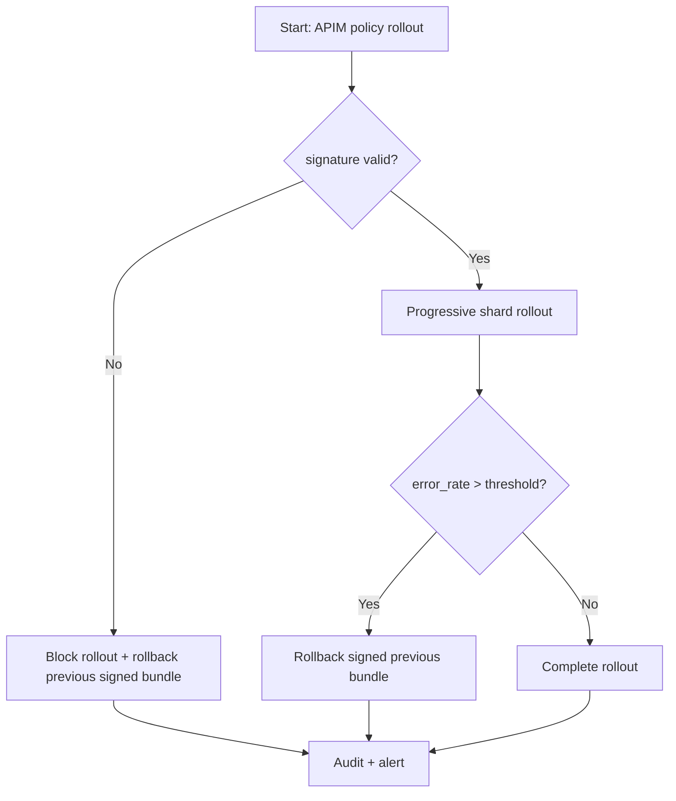
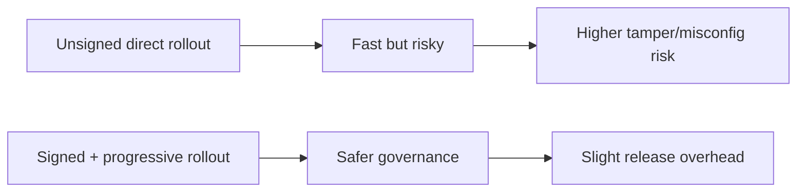
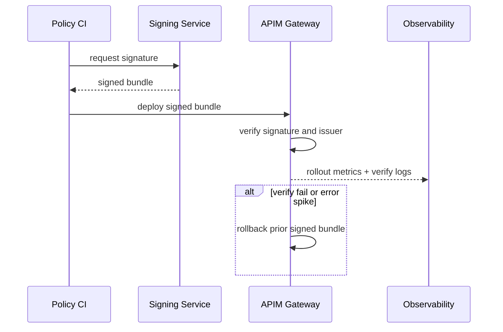

# Agent APIM Policy Bundle Signature Rollout 选型 FAQ（Azure AI Agent Infra）

## 1) 3 分钟结论
- **当策略包更新频率 >4 次/天且策略篡改告警出现时，必须启用策略包签名校验与灰度发布。**
- **策略版本签名失败必须“拒绝执行并回退到已签名上一个稳定版本”。**
- **生产阈值：`signature_verify_fail <0.05%`、`rollback_p95 <40s`、`policy_eval_p95 <20ms`。**

## 2) Q1 / Q2 / Q3
- **为什么策略包要签名？**：防止配置篡改和链路污染。
- **为什么要灰度发布？**：降低全量策略误配造成的大面积拒绝。
- **最小闭环？**：签名发布、验证执行、失败回滚、证据审计。

### Q1：何时必须阻断发布？
签名校验失败或签名主体不在可信列表时。

### Q2：何时可快速全量？
低风险策略变更且预演回放通过。

### Q3：如何量化收益？
比较误拒事件下降与签名验证开销。

## 3) Mermaid 图
### 3.1 决策树

### 3.2 路径对比

### 3.3 时序

## 4) 决策矩阵
| 维度 | 无签名直发 | 签名+灰度（推荐） |
|---|---:|---:|
| 篡改防护 | 低 | 高 |
| 发布风险 | 高 | 低 |
| 发布速度 | 高 | 中 |
| 运维复杂度（1-10） | 3 | 7 |
| 审计可追溯 | 中 | 高 |

## 5) 定量算例与 7-Card 洞察
- 验签风险：`VerifyRisk = VerifyFail / TotalRollouts`
- 回滚收益：`RollbackGain = IncidentLossBaseline - IncidentLossNew`
- 示例（`synthetic_assumed`）：
  - `VerifyFail=2, TotalRollouts=520`
  - `VerifyRisk=0.38%`
  - `IncidentLossBaseline=$320/day, IncidentLossNew=$70/day`
  - `RollbackGain=$250/day`
- 证据：
  - `workshops/azure-agent-infra/evidence/cycle-1467-benchmark.json`
  - `workshops/azure-agent-infra/evidence/cycle-1467-sources.json`
- 标签：`official/synthetic_assumed/not_measured`。

## 6) 生产核验 Checklist
- [ ] 策略包签名与签发主体校验已落地
- [ ] 灰度发布与自动回滚联动生效
- [ ] 签名失败告警可追溯到提交来源
- [ ] 回放验证覆盖关键租户路径
- [ ] FAQ/7-Card 来源标签完整
