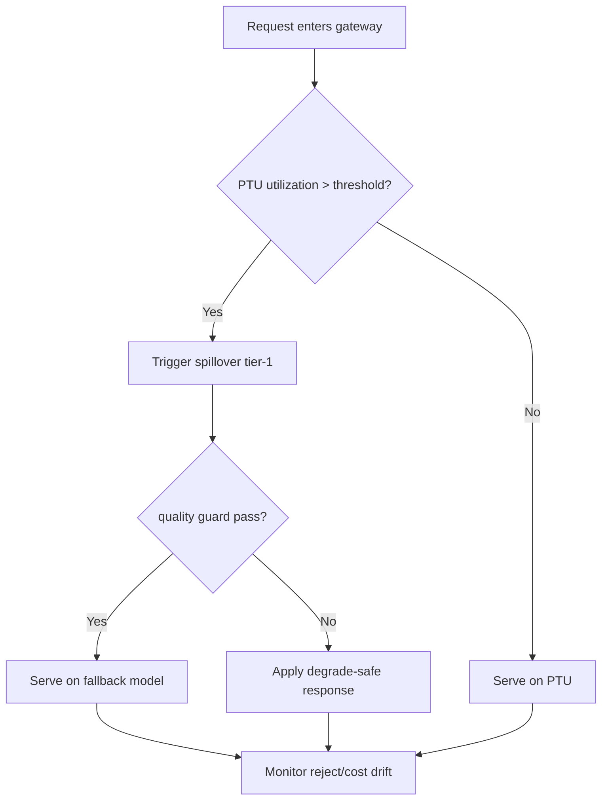
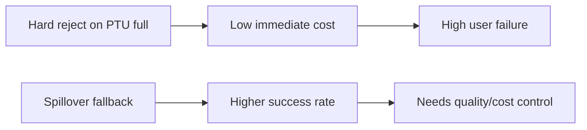
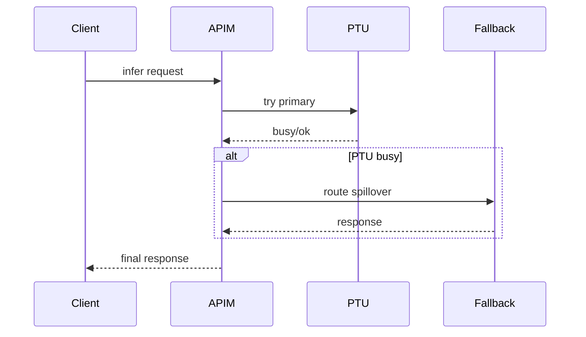

# Agent APIM PTU Spillover Fallback Selection FAQ (Azure AI Agent Infra)

## 1) 3-minute conclusions
- **Without spillover fallback at PTU saturation, APIM can cascade into concentrated rejects and retry storms.**
- **Use pre-threshold triggering + tiered fallback + quality guardrails.**
- **Targets: `ptu_reject <0.6%`, `fallback_p95 <280ms`, `quality_drop <2%`.**

## 2) Q1 / Q2 / Q3
- **Why cascade happens?** PTU congestion drives synchronized retries into backup channels.
- **Why not always route to fallback?** Higher cost and quality variance.
- **Minimum loop?** Warning thresholds, staged diversion, quality gates.

### Q1: When to trigger spillover?
When PTU utilization stays near saturation.

### Q2: When to return to PTU?
When congestion clears and latency stabilizes.

### Q3: How to quantify gain?
Compare reject reduction against cost lift.

## 3) Mermaid diagrams
### 3.1 Decision tree

### 3.2 Path comparison

### 3.3 Sequence

## 4) Decision matrix
| Dimension | Reject when PTU full | Spillover fallback (Recommended) |
|---|---:|---:|
| Success rate | Low | High |
| Cost control | High | Medium-high |
| Ops complexity (1-10) | 3 | 8 |
| User experience | Low | High |
| Quality stability | Medium | Medium-high |

## 5) Quant model + 7-card insights
- Gain: `RejectGain = BaselineReject - FallbackReject`
- Cost lift: `CostLift = FallbackCost - PTUCost`
- Example (`synthetic_assumed`):
  - `BaselineReject=2.8%, FallbackReject=0.5%`
  - `RejectGain=2.3%`
  - `PTUCost=$0.010/session, FallbackCost=$0.012/session`
  - `CostLift=$0.002/session`
- Evidence:
  - `workshops/azure-agent-infra/evidence/cycle-1487-benchmark.json`
  - `workshops/azure-agent-infra/evidence/cycle-1487-sources.json`
- Labels: `official/synthetic_assumed/not_measured`.

## 6) Production verification checklist
- [ ] PTU warning thresholds and diversion rules are versioned
- [ ] Fallback quality guards are auditable
- [ ] Reject/cost drift alerts are configured
- [ ] PTU return conditions are auto-validated
- [ ] FAQ/7-card source labels are complete
